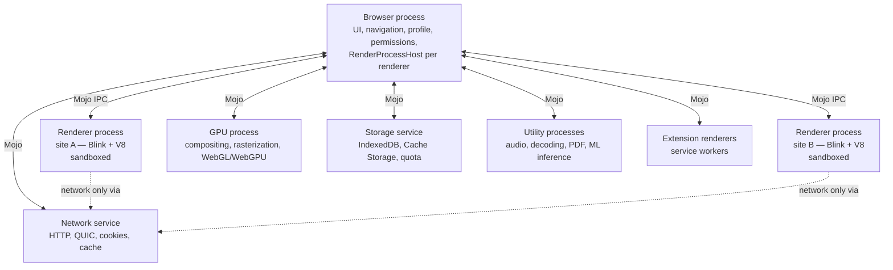

# 01 — Browser Architecture Research

How modern web browsers are designed and developed, with a focus on Chromium, the base Vizulla will build on.

---

## 1. Anatomy of a browser

A browser has a fairly standard set of layers:

```
┌─────────────────────────────────────────────────────────────┐
│ User Interface (tab strip, omnibox, menus, side panels)     │
├─────────────────────────────────────────────────────────────┤
│ Browser Engine (coordinates UI ↔ rendering, navigation,     │
│ session, profiles, permissions)                             │
├──────────────────────────────┬──────────────────────────────┤
│ Rendering Engine (Blink)     │ JavaScript Engine (V8)       │
│ HTML/CSS parse, style,       │ Ignition interpreter,        │
│ layout, paint                │ Sparkplug/Maglev/TurboFan    │
│                              │ JITs, GC (Orinoco), Wasm     │
├──────────────────────────────┴──────────────────────────────┤
│ Networking (HTTP/1.1/2/3, QUIC, TLS, DNS, cache, cookies)   │
├─────────────────────────────────────────────────────────────┤
│ Graphics & Compositing (Skia, GPU process, Viz)             │
├─────────────────────────────────────────────────────────────┤
│ Storage (cookies, IndexedDB, Cache Storage, localStorage,   │
│ OPFS, history/bookmarks DBs)                                │
├─────────────────────────────────────────────────────────────┤
│ Platform layer (OS windows, input, a11y, sandbox, IPC)      │
└─────────────────────────────────────────────────────────────┘
```

### 1.1 Engine families today

| Engine | JS engine | Browsers | Notes |
|---|---|---|---|
| **Blink** (Chromium) | V8 | Chrome, Edge, Brave, Opera, Vivaldi, Arc, Dia, Comet, Atlas | Most of the desktop market. Best web compatibility and extension ecosystem. |
| **Gecko** | SpiderMonkey | Firefox, Zen, Floorp | Independent engine. Smaller embedder ecosystem. |
| **WebKit** | JavaScriptCore | Safari, (all iOS browsers historically) | Apple-led. Weak support for embedding on Windows/Linux. |
| **Servo / Ladybird** | various | experimental | Not production-ready for a general-purpose browser in 2026. |

**Conclusion:** For a browser that must "work as normal browsers" with full site compatibility and Chrome Web Store extensions, Blink/V8 via Chromium is the only practical choice.

---

## 2. Chromium's multi-process architecture

Chromium splits work into separate OS processes for **stability** (one crashing tab does not take down the browser), **security** (untrusted web content runs in sandboxed processes), and **responsiveness**.



| Process | Responsibility | Privilege |
|---|---|---|
| **Browser** | Owns the window and UI, tab/session state, profile, navigation decisions, permission prompts. Holds one `RenderProcessHost` per renderer. | Highest (trusted) |
| **Renderer** | Runs Blink + V8 for web content. One or more per site (Site Isolation). | Sandboxed, lowest |
| **GPU** | Talks to the graphics driver: compositing, rasterization, WebGL/WebGPU, video decode. | Partially sandboxed |
| **Network service** | All network I/O. Renderers reach the network only through it. | Sandboxed on most platforms |
| **Storage service** | Web storage backends and quota. | Restricted |
| **Utility** | Short-lived or isolated jobs: audio, media decode, PDF, unzip, on-device ML. | Sandboxed |

### 2.1 Mojo IPC and services

- **Mojo** is Chromium's IPC system. Interfaces are defined in `.mojom` IDL files, and typed C++/JS bindings are generated from them.
- Chromium has been moving to a **service-oriented** design ("Servicification"). Network, storage, audio, video capture, and so on are separate services that other code reaches only through Mojo interfaces.
- **Why it matters for Vizulla:** the AI runtime should be its own **Mojo service in a sandboxed utility process** (see doc 05). That gives the same isolation guarantees as the network service and lets the AI process restart without touching the UI.

### 2.2 Site Isolation

Each *site* (scheme + eTLD+1) gets its own renderer process, so a compromised renderer cannot read another site's memory (the Spectre/Meltdown defense). This costs memory: more processes. Chromium reduces the cost with process reuse, spare renderers, and process limits under memory pressure.

---

## 3. The rendering pipeline (RenderingNG)

Every frame goes through this pipeline:

```
Navigation → Parse HTML → DOM
                        ↘
          Parse CSS → CSSOM → Style → Layout (LayoutNG) → Pre-paint
                                                         → Paint (display lists)
                                                         → Commit → Tiling → Raster (Skia, GPU)
                                                         → Activate → Aggregate (Viz) → Draw
```

- **Main thread** (per renderer): JS, style, layout, paint recording.
- **Compositor thread**: scrolling and transform/opacity animations, so scrolling stays smooth when the main thread is busy.
- **Viz (GPU process)**: aggregates compositor frames from every renderer and the browser UI, then draws to the screen.

**Implication:** browser UI built with web tech (WebUI) goes through the same compositor. With care, a WebUI shell is not slower than native widgets.

---

## 4. V8 JavaScript engine

| Tier | Role |
|---|---|
| **Ignition** | Bytecode interpreter: fast startup, low memory. |
| **Sparkplug** | Baseline non-optimizing compiler. |
| **Maglev** | Mid-tier optimizing compiler. |
| **TurboFan** | Top-tier optimizing compiler for hot code. |
| **Orinoco GC** | Generational, concurrent, parallel garbage collector. |
| **Liftoff / TurboFan (Wasm)** | WebAssembly baseline and optimizing tiers. |

Vizulla does not change V8. It takes V8 unchanged from upstream Chromium. **Security note:** most Chrome zero-days are in V8, so Vizulla must ship upstream security fixes quickly (see §8).

---

## 5. Networking stack

- HTTP/1.1, HTTP/2, **HTTP/3 over QUIC**, TLS 1.3, certificate verification, HSTS preload.
- **DNS-over-HTTPS** (Secure DNS) with system resolver fallback.
- HTTP cache, cookie store (with partitioning / CHIPS), Private Network Access checks.
- **Content filtering hook points:** Brave-style ad/tracker blocking runs in the network service or browser process, *before* requests leave the machine. Doing it there (instead of in an extension) is faster and is not limited by Manifest V3's `declarativeNetRequest` rule caps.

---

## 6. Security architecture

| Layer | Mechanism |
|---|---|
| Process sandbox | Seccomp-BPF / namespaces (Linux), restricted tokens + AppContainer (Windows), Seatbelt (macOS). |
| Site Isolation | One site per renderer process. |
| Same-Origin Policy, CORS, CORB/ORB | Web-level isolation. |
| Safe Browsing | Phishing/malware URL checks. Vizulla needs its own or a licensed provider. |
| Auto-update | The most important security control: patch quickly. |
| Permissions | Per-origin prompts (camera, mic, location, notifications…). |
| Code integrity | Code signing, notarization (macOS), CFG/CET (Windows). |

**New for AI browsers:** an AI agent that can read pages and act for the user *crosses origins by design*. That breaks the assumption behind the Same-Origin Policy. Security researchers (Trail of Bits, Jan 2026) showed that agentic browsers without proper isolation bring old cross-origin vulnerabilities back. This is the main new security problem; doc 06 covers it.

---

## 7. Extensions

- **Manifest V3** is the current Chromium extension platform: service-worker backgrounds, `declarativeNetRequest`, stricter remote-code rules.
- A Chromium-based browser can support the **Chrome Web Store** by allowing installs from it. Edge, Brave, Vivaldi, and Opera all do this.
- Extensions run in their own renderer processes, and an API permission model controls what they can do.
- Chrome exposes **built-in AI APIs** (Prompt, Summarizer, Writer, Rewriter, Translator, Language Detector, Proofreader) to sites and extensions, backed by Gemini Nano. Chrome's docs note that the foundation-model APIs need a lot of disk space (around 22 GB free on the profile volume) and are not available everywhere. Vizulla could implement the **same API shapes** backed by its own model runtime, so web apps and extensions that use them work in Vizulla too. These APIs are Chrome-specific and still changing, so Vizulla treats them as **Later** scope (SRS AI-06) and follows whatever upstream has shipped. It does not commit to API shapes that are still in origin trials.
- **WebMCP** is a proposed web standard that lets sites expose structured "tools" to AI agents. Calling a declared tool is more reliable and easier to audit than having an agent click through the DOM. It is still a proposal and few sites use it, so Vizulla supports it **behind a flag** for the R3 agent, with the accessibility tree as the fallback (SRS C6, spike S8 in doc 08).

---

## 8. Ways to build a Chromium-based browser

| Approach | What it is | Pros | Cons | Used by |
|---|---|---|---|---|
| **A. Full Chromium fork** (`//chrome` + patches) | Build the Chrome browser target, then add patches and your own components. | Full feature parity (sync model, extensions, PDF, DevTools, policies). Best performance. Full control. | Huge build (~100 GB checkout, hours to build). Every upstream release needs a rebase. Needs dedicated engineers. | Edge, Brave, Vivaldi, Opera, Arc |
| **B. Content-layer embedder** (`//content` API) | Build your own browser on top of the content layer, without `//chrome`. | Cleaner, smaller patch surface. | You rebuild everything `//chrome` provides: extensions, autofill, PDF, password manager. Very large effort. | Some specialty browsers |
| **C. CEF** (Chromium Embedded Framework) | Stable C/C++ embedding API over Chromium. | Easier than a fork. Prebuilt binaries. | Weak extension support. Little control over the internals of the browser process. Not built for "full browser" use. | Spotify, game launchers |
| **D. Electron** | Chromium + Node.js app shell. | Fastest prototyping. Huge talent pool. | Extra Node.js overhead. `<webview>` / `WebContentsView` is limited compared to real tabs. Partial Chrome extension support. Security footguns. Lags Chromium security patches. | Early Arc-like prototypes, many "AI browser" MVPs |
| **E. OS webviews** (WebView2/WKWebView via Tauri) | Use the engine the OS ships. | Small binary. | Different engines per OS. Little control. No real extension support. | Not viable for a full browser |

### 8.1 Maintaining a fork: lessons from industry

- Chromium ships a **new major stable release about every 4 weeks**, with an **8-week Extended Stable** track.
- **Vivaldi** follows Extended Stable because rebasing and stabilizing a large patch set takes time. It keeps its patches as fixups of the original patches to cut down on conflicts.
- **Brave** keeps patches to upstream files **as few and small as possible**. Most of its code lives in its own directories (`brave/`) and is wired in through override files (`chromium_src/`) and a small number of hook patches.
- The Igalia downstream guidance says **rebase, not merge**: merging is riskier given Chromium's size and how fast it changes.
- Trail of Bits observed that many agentic browsers run Chromium builds **weeks or months behind** on security patches. That is a serious weakness Vizulla must avoid.

**Recommendation (ADR-001 in doc 07, status: Proposed):** approach **A** is the leading option, with a Brave-style "overlay" layout: almost all Vizulla code in `vizulla/` and as few upstream patches as possible. Track **Stable** for security, ship Critical/High security fixes within **72 hours** of the upstream Stable release that contains them, and use **Electron (D) only for a throwaway UX prototype** in Phase 0.

A fork's ongoing cost is real: rebases every 4 weeks, a security-merge path, a build farm, and dedicated engineers. So the fork is **not assumed**. It is decided at **Gate G1** (doc 08 §2) by measuring it against a narrower fork (minimal patches, R1 features as a built-in component) and an extension-first fallback. The criteria are the same for every option: security-update lag, rebase cost, extension compatibility, required custom features, build cost, and staffing.

### 8.2 What only a fork (or narrow fork) can deliver

| Required capability | Why an extension or shell can't do it |
|---|---|
| Network-level Shields | MV3 `declarativeNetRequest` rule caps. No access to the network service. |
| Vertical tabs + Spaces replacing the tab strip | Extensions can add a side panel but cannot replace the browser's tab UI. |
| Command Bar replacing the omnibox | Extensions can only add omnibox keywords. |
| Browser-owned confirmation UI | Extension UI can be imitated by pages and does not sit in a trusted surface. |
| Sandboxed AI utility process | Extensions cannot create sandboxed processes or broker file handles. |
| Owning the security-update path | Only possible when we ship the binary. |

---

## 9. Performance and memory techniques worth adopting

| Technique | Description |
|---|---|
| **Tab discarding (Memory Saver)** | Kill the renderer of an inactive tab and keep its title/favicon. The page reloads when the tab is opened again. |
| **Tab freezing (Energy Saver)** | Pause JS timers and tasks in background tabs, especially on battery. |
| **Back/forward cache** | Keep recently visited pages in memory for instant back/forward. |
| **Process consolidation under pressure** | Fewer renderer processes when memory is low. |
| **Lazy UI** | Do not create side panels or AI features until first used. |
| **Predictive discard** | Use local signals to predict which tabs will not be revisited. Vizulla can use its own on-device model for this. |
| **PartitionAlloc, pointer compression** | Upstream memory work Vizulla gets for free. |

What makes a browser "light" is mostly **how well it manages tabs and processes, and what extra features it runs**, not which engine it uses. Vizulla's AI features must be **lazily loaded, out-of-process, and unloadable**.

---

## 10. Key takeaways for Vizulla

1. Build on **Chromium**. A full fork with an overlay layout is the leading option, **confirmed or replaced at Gate G1 on measured cost** (doc 08 §2).
2. Treat **security patch speed** as a top product requirement, not an ops chore. Rehearse it before beta (doc 08 §5).
3. Put the **AI runtime in its own sandboxed Mojo service**, like the network service (R2; R1 uses cloud models through the browser process).
4. Track **WebMCP** and the **built-in AI web APIs** behind flags. Do not commit launch scope to interfaces that may change.
5. Make **ad/tracker blocking native** (network service), not an extension.
6. Keep the browser light with **aggressive tab lifecycle management** and **lazy AI loading**.
7. Treat **cross-origin agent actions** as the defining new security problem. Enforce limits deterministically, and treat detection as defense in depth (doc 06 §1.1).

---

## Sources

- [Chromium — Multi-process Architecture](https://chromium.org/developers/design-documents/multi-process-architecture)
- [Chromium — Intro to Mojo & Services](https://chromium.googlesource.com/chromium/src/+/312b6bf/docs/mojo_and_services.md)
- [Chromium — Design Documents](https://www.chromium.org/developers/design-documents)
- [Chromium architecture overview (Sprocket)](https://szeged.github.io/sprocket/architecture_overview.html)
- [Chrome for Developers — Built-in AI](https://developer.chrome.com/docs/ai/built-in?hl=en)
- [Chrome for Developers — Get started with built-in AI](https://developer.chrome.com/docs/ai/get-started?authuser=1)
- [Chrome for Developers — Extensions and AI](https://developer.chrome.com/docs/extensions/ai)
- [Igalia — Maintaining Chromium downstream: update strategies](https://blogs.igalia.com/dape/2024/09/13/maintaining-chromium-downstream-update-strategies/)
- [Vivaldi — Under the browser hood with Yngve](https://vivaldi.com/?p=441493)
- [Omaha Consulting — How to fork Chromium](https://omaha-consulting.com/how-to-fork-chromium)
- [Trail of Bits — Lack of isolation in agentic browsers resurfaces old vulnerabilities](https://blog.trailofbits.com/2026/01/13/lack-of-isolation-in-agentic-browsers-resurfaces-old-vulnerabilities/)
- [Better Stack — Tauri vs Electron vs Deno Desktop vs Electrobun](https://betterstack.com/community/guides/scaling-nodejs/tauri-vs-electron-vs-deno-vs-electrobun.md)
- [Tauri issue #5889 (memory comparison)](https://github.com/tauri-apps/tauri/issues/5889)
- [Tom's Guide — Chrome tab memory](https://www.tomsguide.com/news/this-free-extension-fixes-chromes-biggest-problem-and-i-tried-it)
- [TechRadar — Chrome tab freezing](https://www.techradar.com/news/chromes-new-feature-will-stop-tabs-from-eating-all-your-ram-heres-how-to-try-it)
