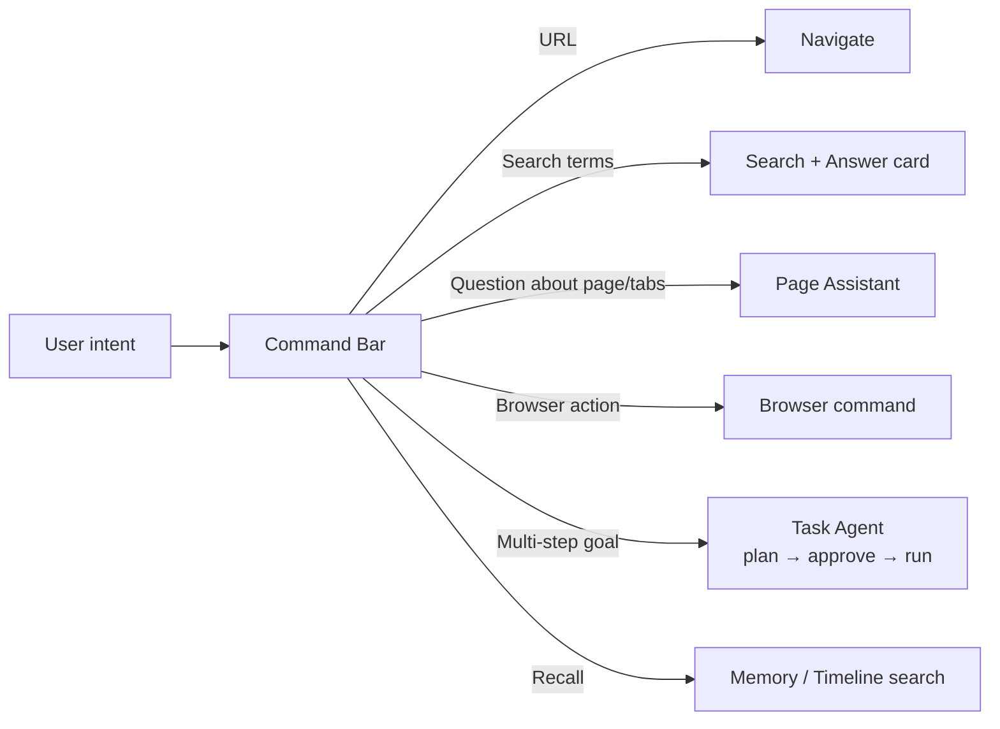

# 03 — Traditional → Modern Browsing Transition

Browsing habits have barely changed since about 2008: tabs across the top, a URL bar, a bookmarks bar, a history list, a downloads list. Vizulla keeps every one of these **working and reachable** (no user is forced to change) and adds an AI-native version that is simpler for most tasks.

**Design principle:** *Modern by default, traditional on demand.* Every modern feature has a "classic" fallback in Settings → Appearance → Classic mode.

**Release column:** the release that first ships each modern equivalent (doc 07 §1). Until then, the classic behavior is the only behavior. The classic fallback for every row ships in R1, because it is mostly upstream Chromium.

---

## 1. Transition map

| # | Traditional concept | Pain today | Vizulla modern equivalent | Classic fallback | Release |
|---|---|---|---|---|---|
| T1 | **Address bar / omnibox** | Users must know a URL or phrase a keyword search. | **Command Bar** (`Ctrl/⌘+K` or `Ctrl/⌘+L`): one input that accepts a URL, a search, a question, or an action ("open my last PDF", "mute all tabs", "summarize this"). Intent is classified locally. | Plain URL/search bar. | R1 (AI intents R2) |
| T2 | **Horizontal tab strip** | Tabs shrink to unreadable icons. 50+ tabs become chaos. | **Vertical tab sidebar** with **Spaces** (Work / Study / Personal). **Auto-archive** of idle tabs (configurable, default 12 h), and **AI auto-grouping** with readable names. | Horizontal tab strip. | R1 (AI grouping R2) |
| T3 | **Bookmarks** | Saved and never found again. Folders nobody maintains. | **Pins + Memory**: pinned tabs per Space, plus a searchable personal knowledge base. "Save" stores page text and an AI summary, so meaning-based recall works ("that pricing page with the blue chart"). | Bookmarks bar and manager. Import/export as HTML. | R2 (pins R1) |
| T4 | **History list** | Chronological dump, keyword-only search. | **Timeline + natural-language recall**: sessions grouped by task and searched by meaning, on-device. | Classic `vizulla://history`. | R2 |
| T5 | **Search engine results page** | Ten blue links, ads, SEO spam. | **Answer card** above results: a short, cited synthesis from the user's chosen search provider plus the AI model. Results are always shown. The answer never replaces them. | Answer card off. | Later |
| T6 | **Reading a long page** | Scroll, skim, lose focus. | **Page Assistant**: TL;DR, key points, Q&A, and "explain like I'm new" in the side panel. A **Reader** view strips clutter. | Reader mode only. | R1 |
| T7 | **Comparing across tabs** | Manual copy and paste into a doc. | **Multi-tab chat**: select tabs and ask "compare these three laptops in a table". | — | R2 |
| T8 | **Filling forms** | Repetitive typing. Autofill only handles addresses. | **Smart Fill**: suggests values from the user's profile and Memory for the fields it understands, and the user reviews them before anything is submitted. | Standard autofill. | R3 Stage B |
| T9 | **Doing multi-step tasks** (book, buy, file) | Many clicks across many pages. | **Task Agent**: the user describes the goal, the agent shows a plan, runs it step by step with visible actions, and pauses for approval at sensitive steps. | Agent disabled. | R3 |
| T10 | **Downloads list** | Files named `document(7).pdf`. | **Smart Downloads**: AI-suggested file names, a summary of each file, and grouping by Space/task. | Classic list. | Later |
| T11 | **Translation** | A banner offering to translate the whole page. | **Inline translate** of a selection or the whole page, on-device when the language pair is supported. | Page translate banner. | R2 |
| T12 | **Ad-block / privacy** | Users must find and install extensions. | **Shields built in**: ad, tracker, and fingerprinting protection, on by default and adjustable per site. | Turn off per site or globally. | R1 |
| T13 | **Settings** | Hundreds of toggles nobody can find. | **Ask Settings**: "make text bigger on all sites", "stop notifications from news sites". The command bar finds or applies the setting, with confirmation. | Classic settings page. | R2 |
| T14 | **Notes / clipping** | A separate app. Context gets lost. | **Notes panel**: clip a selection with its source link and AI tags. Notes are linked to the page and the Space. | — | R2 |
| T15 | **Tab overload / RAM** | Browser slows down and fans spin. | **Sleep & Restore**: predictive tab discard plus a "Focus" button that hibernates everything outside the current Space. | Memory Saver toggle. | R1 (predictive R2) |
| T16 | **Screenshots** | An OS tool, then manual cropping. | **Capture**: region or full-page capture, with OCR, "explain this chart", and redaction. | Plain screenshot. | Later |
| T17 | **Password manager** | Separate app or weak defaults. | **Built-in vault** with passkeys, breach alerts, and E2EE sync. **The AI never reads stored secrets** (doc 06). | Import from Chrome, 1Password, Bitwarden. | R1 (sync R2) |
| T18 | **New tab page** | Speed dials, news feeds, ads. | **Calm start page**: Command Bar, the current Space's pins, and "continue where you left off". No feeds and no ads. | Custom wallpaper / speed dial. | R1 |

---

## 2. Interaction model

**R1:** routing is deterministic: URL/domain grammar → navigate, `>` → browser command, `?` or the "Ask" chip → Page Assistant, everything else → search. A URL is never sent to AI (CMD-07). The Recall and Multi-step goal routes do not exist yet.

**R2:** an on-device classifier adds natural-language commands and recall, in **under 30 ms**. When it is unsure (confidence < 0.7), the Command Bar shows the top 2–3 interpretations as chips instead of guessing. **R3** adds the agent-task route.

---

## 3. Simplification principles

1. **One input for everything.** The Command Bar replaces the URL bar, the search box, the settings search, and the history search.
2. **The browser tidies itself.** Tabs archive, group, and sleep automatically, and every change can be undone.
3. **Recall by meaning, not location.** Users do not need to remember where something was saved, only what it was about.
4. **AI is quiet until asked.** No pop-ups, no "Try AI!" banners. At most one subtle hint per feature.
5. **Every AI action is visible and reversible.** The Action Log shows what the AI did, and each entry has an Undo.
6. **Respect existing habits.** Classic mode is fully supported, and keyboard shortcuts match Chrome.
7. **Privacy you can see.** A shield icon shows what was blocked, and an AI indicator shows whether processing happened *on device* or *in the cloud*.

---

## 4. Onboarding flow (first run)

1. **Import** from Chrome, Edge, Firefox, or Safari (R1), and from Brave, Opera, Vivaldi, or Arc (R2): bookmarks, passwords, history, open tabs. Extensions are re-installed from the Chrome Web Store.
2. **Choose a layout**: Modern (vertical tabs + Spaces) or Classic (horizontal tabs).
3. **Choose AI mode**:
   - *Vizulla cloud* (R1): the Vizulla Gateway with a free quota, zero data retention, and a disclosure the first time per site.
   - *Bring your own key*: Anthropic, OpenAI, Google, or an OpenAI-compatible endpoint, including a local server such as Ollama.
   - *Local only* (R2): the on-device model, no cloud.
   - *Hybrid* (R2, becomes the recommended default): local first, cloud for heavy tasks, with per-task disclosure.
   - *AI off*: a plain fast browser.
4. **Memory opt-in** (R2): "Let Vizulla remember pages you visit so you can search them by meaning. Stored only on this device, encrypted." Off by default.
5. **Finish.** No account required.
