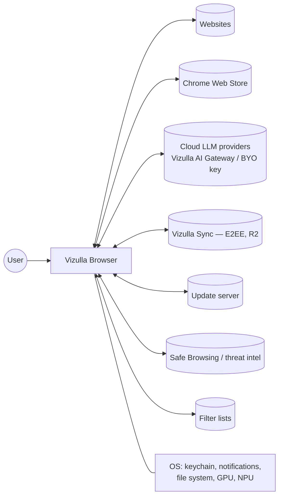

# 04 — Software Requirements Specification (SRS)

**Product:** Vizulla, an AI-native desktop browser
**Version:** 0.2 (Draft) · **Date:** 2026-11-07
**Structure:** based on ISO/IEC/IEEE 29148:2018

> **What changed in 0.2.** Each requirement now has a **target release** (R1/R2/R3/Later) and a **verification method**. v1.0 is now the narrow **R1** release. The performance targets have defined workloads, devices, and pass rules (§7.2). Agent requirements follow an explicit capability model (§3.6, doc 06 §5). Where scope was inconsistent (sync, Task Agent flag, launch languages), it has been resolved. See doc 07 §1 for the release plan.

---

## Table of contents

1. [Introduction](#1-introduction)
2. [Overall description](#2-overall-description)
3. [Functional requirements](#3-functional-requirements)
4. [External interface requirements](#4-external-interface-requirements)
5. [Non-functional requirements](#5-non-functional-requirements)
6. [Constraints, assumptions, dependencies](#6-constraints-assumptions-dependencies)
7. [Acceptance criteria & verification](#7-acceptance-criteria--verification)
8. [Traceability & ownership](#8-traceability--ownership)
9. [Glossary](#9-glossary)

---

## 1. Introduction

### 1.1 Purpose
This SRS defines the functional and non-functional requirements for Vizulla, a desktop web browser built on Chromium that combines full standard-browser capability with built-in, privacy-respecting AI. It is the **acceptance contract for each release**: a release ships when every requirement targeted at it is verified by the method listed. Its readers are product management, engineering, QA, security, and design.

### 1.2 Scope

Vizulla is delivered in three releases (doc 07 §1):

| Release | Name | Adds |
|---|---|---|
| **R1 = v1.0** | Browser + Assistant | A reliable Chromium browser (import, core navigation, extensions, passwords), Shields, vertical tabs + Spaces, Command Bar, and **one assistant workflow**: *ask about this page or PDF, with citations*, through cloud or user-configured models. AI is **read-only**. |
| **R2 = v1.x** | Memory + Local AI | Bundled on-device model runtime, Memory (opt-in), Notes, AI tab grouping, natural-language commands, E2EE sync, more platforms and languages. |
| **R3 = v2.0** | Supervised Agent | The Task Agent, introduced in capability stages (doc 06 §5.3). |

Requirements marked **Later** are documented intent, not commitments.

Out of scope for all three releases: mobile apps (iOS/Android), a built-in VPN, a crypto wallet, an email client, and a custom search index.

### 1.3 Definitions
See [§9 Glossary](#9-glossary).

### 1.4 References
- Doc 01 Browser Architecture Research · Doc 02 Market Analysis · Doc 03 Transition Map · Doc 05 Architecture · Doc 06 Security · Doc 07 Roadmap · Doc 08 Validation Plan
- Chromium design documents; ISO/IEC/IEEE 29148; WCAG 2.2; OWASP Top 10 for LLM Applications; GDPR; Rwanda Law No. 058/2021 on Protection of Personal Data and Privacy.

### 1.5 Requirement notation
- **ID format:** `<AREA>-<NN>`, e.g. `TAB-03`. IDs are stable. Withdrawn IDs are not reused.
- **Target (Tgt):** **R1**, **R2**, **R3**, or **Later**. A requirement targeted at a release is mandatory for that release's gate.
- **Verification (Ver):** **T** automated test · **B** benchmark (§7.2 method) · **E** AI evaluation suite · **S** security review / pentest / fuzzing · **U** usability study · **A** accessibility audit · **P** privacy review / DPIA · **D** demonstration or inspection.
- **Platform:** a requirement applies to every supported platform (§2.4) unless it names one.
- "Shall" = mandatory, "should" = recommended.
- Owners and dependencies are listed per area in [§8.2](#82-ownership--dependencies).

---

## 2. Overall description

### 2.1 Product perspective
Vizulla is a downstream Chromium distribution in the same family as Edge, Brave, and Vivaldi. It adds a `vizulla/` overlay with UI, AI services, Shields, and later Memory and the Agent (see doc 05). The full-fork approach is the leading option, confirmed or replaced at Gate G1 (doc 08 §2).

### 2.2 Product functions (summary)

| # | Function | First release |
|---|---|---|
| 1 | Standard browsing (navigation, tabs, windows, profiles, downloads, printing, PDF) | R1 |
| 2 | Modern organization (vertical tabs, Spaces, auto-archive) | R1 |
| 3 | Command Bar (unified URL, search, and command input) | R1 (AI intent: R2) |
| 4 | Page Assistant: ask about this page/PDF, with citations | R1 |
| 5 | Shields (ad and tracker blocking) | R1 |
| 6 | Identity and security (password manager, passkeys, Safe Browsing) | R1 |
| 7 | Import and extensions | R1 |
| 8 | Multi-tab synthesis, selected-text actions, translation | R2 |
| 9 | Memory (semantic history, saves) and Notes | R2 |
| 10 | Sync (E2EE) | R2 |
| 11 | Task Agent (supervised multi-step web actions) | R3 |

### 2.3 User classes

| Class | Description | Key needs | Primary in |
|---|---|---|---|
| UC1 Everyday user | Non-technical, mixed hardware | Simple, fast, safe, works offline | R2 |
| UC2 Knowledge worker | Heavy multi-tab research | Spaces, synthesis, notes, Memory | **R1** |
| UC3 Student | Low-cost hardware, PDFs | Summaries, PDF Q&A, low RAM use | **R1** |
| UC4 Developer | Builds for the web | DevTools, local models, AI debugging | R2 |
| UC5 Administrator | Manages a fleet | Policies, AI governance, audit logs | Later |

R1 targets UC2 and UC3 (decision D-2, doc 07 §3). The R1 assistant workflow, reading and questioning pages and PDFs, is chosen for these two classes.

### 2.4 Operating environment

| Platform | Release | Minimum (browsing) | Local AI profile (R2) |
|---|---|---|---|
| Windows 10 22H2 / 11, x64 | **R1** | 4 GB RAM | 16 GB RAM, or 8 GB with a supported GPU/NPU |
| macOS 13+, Apple Silicon | **R1** | 8 GB RAM | 16 GB recommended (Metal) |
| Windows 11 ARM64 | R2 | 8 GB RAM | NPU via the runtime chosen in spike S4 |
| macOS 13+, Intel | R2 | 8 GB RAM | Cloud AI only |
| Linux x64 (Ubuntu 22.04+, Fedora 39+) | R2 (nightly builds from R1, unsupported) | 4 GB RAM | Vulkan-capable GPU |
| Disk | — | 600 MB browser | +2–6 GB per optional local model |

The R1 platforms are decision D-1 (doc 07 §3). Chromium builds for every platform. The cost of adding one is mostly QA, signing, packaging, and updater work.

On devices below the local AI profile, the browser **shall** run fully, with AI falling back to the cloud (if enabled) or turned off.

### 2.5 Design and implementation constraints
- C1: Must be based on Chromium, tracking the Stable channel (ADR-001/002, confirmed at Gate G1).
- C2: Upstream security fixes must ship within the SLO in `SEC-01`.
- C3: Must comply with the licenses of Chromium (BSD) and its third-party components.
- C4: Must not use Google-proprietary services (Google sync, the Google Safe Browsing API, Google's password leak-detection service) without a license. Use alternatives or licensed services.
- C5: AI features must be pluggable: no hard dependency on a single model provider.
- C6: No launch scope may depend on an interface that is not yet a shipped standard or stable API (WebMCP, Chrome built-in AI APIs). Such features are flag-gated and have a defined fallback.

### 2.6 Assumptions & dependencies

| ID | Assumption | Validated by | If false |
|---|---|---|---|
| A1 | Users with cloud AI have internet access. Local mode works offline. | — | — |
| A2 | Open-weight small models (1–8B parameters) of acceptable quality remain available under permissive licenses. | Spike S4 | R2 local AI narrows to embeddings/classification only. |
| A3 | EasyList/EasyPrivacy-compatible filter lists remain available. | License review | Maintain our own lists. |
| A4 | Chrome Web Store installs keep working in third-party Chromium browsers. | Spike S3, ongoing monitoring | Side-loading plus partner outreach (risk R4). |
| A5 | A full-fork rebase fits within the platform team's capacity. | Spikes S1/S2 (Gate G1) | Switch to the fallback in doc 08 §2.4. |
| A6 | A licensed threat-intel feed is affordable at launch scale. | Spike S9 | Delay R1 GA. Safe Browsing protection is a release blocker. |

---

## 3. Functional requirements

### 3.1 Core browsing (CORE)

| ID | Requirement | Tgt | Ver |
|---|---|---|---|
| CORE-01 | The system shall render web content with Blink/V8 with no Web Platform Test regressions against upstream Chromium at the same tag, measured as defined in §7.2 (M-WPT). | R1 | T |
| CORE-02 | The system shall support multiple windows, tabs, private (incognito) windows, and guest mode. | R1 | T |
| CORE-03 | The system shall support multiple **profiles** with upstream Chromium isolation (cookies, storage, history, extensions). From R2, AI Memory is also per profile. | R1 | T |
| CORE-04 | The system shall provide back/forward, reload, stop, zoom (per site), find-in-page, print, and save-page. | R1 | T |
| CORE-05 | The system shall include a PDF viewer with text selection and search. Highlights and annotations saved to the file come in R2. | R1 | T |
| CORE-06 | The system shall include a download manager with pause/resume, open, show-in-folder, and dangerous-file warnings. | R1 | T |
| CORE-07 | The system shall include Chromium DevTools. | R1 | D |
| CORE-08 | The system shall support picture-in-picture, media controls, casting (where available), and global media hotkeys. | R2 | T |
| CORE-09 | The system shall restore the previous session after a restart or crash with no tab loss (REL-03). | R1 | T |
| CORE-10 | The system shall support being set as the OS default browser and handling `http`, `https`, `mailto`, and `.pdf`/`.html`. | R1 | T |

### 3.2 Tabs, Spaces & layout (TAB)

| ID | Requirement | Tgt | Ver |
|---|---|---|---|
| TAB-01 | The system shall offer **vertical tabs** (default) and **horizontal tabs** (classic), switchable at runtime. | R1 | T, U |
| TAB-02 | The system shall support **Spaces**: named, colored, icon-tagged containers of tabs and pins. A Space may optionally map to a profile (R2). | R1 | T, U |
| TAB-03 | The system shall support pinned tabs per Space and tab groups within Spaces. | R1 | T |
| TAB-04 | The system shall **auto-archive** unpinned tabs idle longer than a configurable threshold (default 12 h, range 1 h – never). Archived tabs are searchable and restorable for 30 days. | R1 | T |
| TAB-05 | The system shall offer **AI auto-grouping**: on request or automatically, it proposes groups with readable names. The user can accept, edit, or undo. | R2 | T, E |
| TAB-06 | The system shall provide **split view** (2–4 panes) within a window. | R2 | T |
| TAB-07 | The system shall discard inactive tabs under memory pressure (R1). Predictive discard with an on-device model comes in R2. Users can exempt sites. | R1 | T, B |
| TAB-08 | The system shall freeze background tabs on battery (Energy Saver) and provide a one-click **Focus** that sleeps all tabs outside the active Space. | R1 | T |
| TAB-09 | The system shall show per-tab memory and CPU usage on hover and in a built-in task manager. | R2 | T |
| TAB-10 | The system shall offer a tab search (`Ctrl/⌘+Shift+A`) across all windows, Spaces, and the archive. | R1 | T |

### 3.3 Command Bar (CMD)

| ID | Requirement | Tgt | Ver |
|---|---|---|---|
| CMD-01 | The system shall provide a single Command Bar that accepts URLs, search queries, questions for the assistant, and browser commands. | R1 | T, U |
| CMD-02 | **R1:** the system shall classify input **deterministically** (URL/domain grammar, command grammar, `?` or "Ask" prefix, everything else = search) within 5 ms p95. **R2:** an on-device model adds intent classes (ask-general, command, recall, later agent-task) within 30 ms p95 on RD-1. | R1/R2 | T, B, E |
| CMD-03 | When model intent confidence < 0.7, the system shall show alternative interpretations as selectable chips. | R2 | T, U |
| CMD-04 | The system shall offer suggestions from open tabs, pins, history, and the search provider (R1), plus Memory (R2), ranked by relevance. | R1 | T |
| CMD-05 | The system shall run browser commands from natural language (e.g. "close tabs from youtube", "clear cookies for this site") and require browser-owned confirmation for destructive commands. | R2 | T, E |
| CMD-06 | The system shall let the user choose the default search provider and shall not force any provider. | R1 | T |
| CMD-07 | Typing a bare URL or domain shall always navigate, with no AI involved (AIQ-04). | R1 | T |
| CMD-08 | The system shall provide a fixed-grammar command palette (e.g. "> new space", "> mute tab") with fuzzy matching. | R1 | T |

### 3.4 Page Assistant (PA)

| ID | Requirement | Tgt | Ver |
|---|---|---|---|
| PA-01 | The system shall provide a side-panel assistant that can summarize the current page (TL;DR, key points, outline). | R1 | T, E |
| PA-02 | The system shall answer questions about the current page with **citations** (scroll-to and highlight of the source passage). This is the R1 core workflow. | R1 | T, E, U |
| PA-03 | The system shall support selected-text actions: explain, simplify, translate, define, rewrite, proofread. | R2 | T, E |
| PA-04 | The system shall summarize and answer questions about PDFs (R1) and video transcripts, where available (R2). | R1 | T, E |
| PA-05 | The system shall support **multi-tab context**: the user selects up to 20 tabs and asks for comparison or synthesis. Output can be a table or document. | R2 | T, E |
| PA-06 | The system shall show where each response was processed (**On device** / **Cloud: provider name**). | R1 | T, D |
| PA-07 | The system shall provide Reader view with adjustable typography and text-to-speech. | R1 | T |
| PA-08 | The system shall provide page translation, on-device for supported language pairs, with **Kinyarwanda, Swahili, French, and English** as priority pairs (subject to model quality in spike S4). | R2 | E |
| PA-09 | The system shall let the user copy AI outputs to the clipboard or export them as Markdown (R1), and send them to Notes (R2). | R1 | T |
| PA-10 | The assistant shall only read content the user asked about (current page, a selection, or a PDF the user opened). It shall not read other tabs, history, or profile data in R1. | R1 | T, S |

### 3.5 Memory & knowledge (MEM)

| ID | Requirement | Tgt | Ver |
|---|---|---|---|
| MEM-01 | The system shall offer **opt-in** semantic indexing of visited pages (text + embeddings) stored **locally**, encrypted with an OS-keychain-protected key. | R2 | T, S, P |
| MEM-02 | The system shall never index private windows, pages in configured "sensitive" categories (banking, health, adult; on by default), or sites on the user's exclusion list. | R2 | T, P |
| MEM-03 | The system shall support natural-language recall ("the recipe with lentils I saw on Tuesday") across history, saves, notes, and downloads. | R2 | T, E, U |
| MEM-04 | The system shall provide a **Timeline** view grouping history into task sessions. | Later | T |
| MEM-05 | The system shall provide **Save to Memory** (replacing bookmarks in modern mode) with auto-tags and a summary. Classic bookmarks stay available and work alongside it. | R2 | T |
| MEM-06 | The system shall provide a **Notes** panel: clip selections with the source link, rich text, Markdown export. | R2 | T |
| MEM-07 | The system shall let the user view, search, edit, and delete any Memory item, and wipe all Memory in one action. Deletion follows doc 06 §7. | R2 | T, P |
| MEM-08 | Memory shall sync between devices only if the user turns on E2EE sync for Memory specifically. | Later | T, S |

### 3.6 Task Agent (AGT)

The agent is introduced in capability stages (doc 06 §5.3). Stage A (R3) runs only in an isolated Agent Session and can navigate, read, and interact, but cannot submit, send, or fill personal data. Stage B (R3.x) adds personal-data fill and commit actions after the AIQ-02/03 gates pass. Credential fill (T5) is **Later**.

| ID | Requirement | Tgt | Ver |
|---|---|---|---|
| AGT-01 | The system shall accept a natural-language goal and produce a **visible plan** (steps, origins, capability tiers, and data fields to be used) before execution. The plan is a structured object enforced by the browser (AGT-11), not just text. | R3 | T, U |
| AGT-02 | The agent shall act using, in order of preference: (1) **WebMCP** tools declared by the site, where supported (flag-gated, C6), (2) accessibility-tree actions, (3) DOM actions, (4) vision-based actions as a last resort. Every path goes through the same browser-side validation. | R3 | T, E |
| AGT-03 | The agent shall run in a **visible tab** with an action overlay (highlighted target, step label). The user can pause, take over, or stop at any time (`Esc`). | R3 | T, U |
| AGT-04 | The agent shall require **explicit user confirmation in browser-owned UI** before: purchases or payments, submitting forms with personal data, sending messages or email, posting content, changing account settings, downloading executables, and authenticating to a new site. The confirmation shows the exact data and destination. | R3 (Stage B) | T, S |
| AGT-05 | The agent shall be confined to the **origins approved in the plan**. Navigating to a new origin requires re-approval. Enforcement is in the browser process (AGT-11). | R3 | T, S |
| AGT-06 | The agent shall **never** receive password vault contents, payment card data, or passkeys. Credential fill is done by the browser after user confirmation, without exposing secrets to the model. | R3 | T, S |
| AGT-07 | The agent shall run by default in an **Agent Session** with a separate storage partition. Stage A has no option to use the user's logged-in session. In Stage B the user may grant it per origin, for a limited time. | R3 | T, S |
| AGT-08 | All agent actions shall be logged in the **Action Log** with timestamp, origin, action, data fields sent, confirmation record, and model reasoning summary. Retention follows doc 06 §7. | R3 | T |
| AGT-09 | The system shall run an injection detector on untrusted content and pause the agent to ask the user when instructions in page content try to change its goal. This is **defense in depth**: no other control may depend on detection succeeding. | R3 | E, S |
| AGT-10 | The system shall support recurring/background agent tasks (e.g. "check this price daily") with notifications. | Later | T |
| AGT-11 | The browser process shall **deterministically** reject any agent action outside the approved plan's origins, capability tiers, or declared data fields, regardless of model output. | R3 | T, S |
| AGT-12 | Data sent by an agent action shall be limited to: values typed by the user in the plan, profile fields named in the plan (Stage B), and content read from the **same** origin it is sent to. Data from other origins, Memory, or other tabs shall not be sent unless the user approves it in the plan or a confirmation (doc 06 §5.2). | R3 | T, S |

### 3.7 AI platform (AI)

| ID | Requirement | Tgt | Ver |
|---|---|---|---|
| AI-01 | The system shall include an **on-device model runtime** in a sandboxed utility process, using **one inference engine** chosen in spike S4, with GPU acceleration on each supported platform. More engines/NPUs are added only when benchmarks justify them. | R2 | T, B, S |
| AI-02 | The system shall download on demand a default small model (~1–4B parameters) for classification, summarization, and grouping, plus a separate embedding model. | R2 | T, E |
| AI-03 | The system shall support cloud providers through (a) the Vizulla AI Gateway with a free quota and (b) user-supplied API keys for Anthropic, OpenAI, Google, and any OpenAI-compatible endpoint (including local servers such as Ollama/LM Studio). | R1 | T |
| AI-04 | The system shall route each task by policy. **R1:** the user's mode and chosen provider. **R2:** a model router choosing local or cloud by mode, task kind, device capability, and sensitivity (doc 05 §4.2). | R1/R2 | T |
| AI-05 | The system shall never send page content to a cloud model unless the user's mode allows it. In Hybrid mode, the first cloud use per site shows a one-time disclosure. | R1 | T, P |
| AI-06 | The system shall expose **Chrome-compatible built-in AI web APIs** (Prompt, Summarizer, Writer, Rewriter, Translator, Language Detector) backed by the Vizulla runtime, behind a per-origin permission, tracking whatever upstream has shipped (C6). | Later | T |
| AI-07 | The system shall support **WebMCP** discovery and invocation for the agent, behind a flag while the proposal is unstable (C6). | R3 | T |
| AI-08 | The system shall unload local models after 5 minutes idle (configurable) and under memory pressure. | R2 | T, B |
| AI-09 | The system shall let the user disable all AI with one switch, after which no AI process starts and no AI request is sent. | R1 | T |
| AI-10 | The system shall support **MCP client** connections to user-configured MCP servers (e.g. calendar, files) with per-tool approval. | Later | T, S |

### 3.8 Shields: privacy & content blocking (SHD)

| ID | Requirement | Tgt | Ver |
|---|---|---|---|
| SHD-01 | The system shall block ads and trackers natively (network-service level) using EasyList/EasyPrivacy-compatible lists, on by default. | R1 | T, B |
| SHD-02 | The system shall support per-site Shields toggles and show a blocked-count indicator. | R1 | T |
| SHD-03 | The system shall provide fingerprinting protection (farbling or standardization) without breaking major sites (≤ 1% breakage on the site-compat list). | R2 | T |
| SHD-04 | The system shall block third-party cookies by default (R1) and auto-dismiss cookie banners by rejecting non-essential cookies (R2). | R1 | T |
| SHD-05 | The system shall support DNS-over-HTTPS with a selectable resolver. | R1 | T |
| SHD-06 | The system shall upgrade connections to HTTPS by default (HTTPS-First). | R1 | T |

### 3.9 Identity & security features (ID)

| ID | Requirement | Tgt | Ver |
|---|---|---|---|
| ID-01 | The system shall include a password manager with generation, autofill, and CSV import/export (R1), plus k-anonymity breach checks through a non-Google provider (C4, spike S9). | R1 | T, S |
| ID-02 | The system shall support passkeys (WebAuthn) and OS authenticators. | R1 | T |
| ID-03 | The system shall protect vault access with OS authentication (Windows Hello / Touch ID; PAM on Linux in R2). | R1 | T |
| ID-04 | The system shall provide phishing and malware protection through a licensed or self-operated threat-intel service. **This blocks R1 GA.** | R1 | T, S |
| ID-05 | The system shall offer an on-device AI **"Is this site safe?"** explainer for suspicious pages, as an *extra* signal that never replaces ID-04. | Later | E |

### 3.10 Sync, import & extensions (SYN / EXT)

| ID | Requirement | Tgt | Ver |
|---|---|---|---|
| SYN-01 | The system shall provide optional **end-to-end encrypted** sync of tabs, Spaces, bookmarks, history, passwords, and settings. Memory sync is MEM-08 (Later). | R2 | T, S |
| SYN-02 | Sync shall work without an email account, using a sync code (as in Brave's sync chain) or an optional Vizulla account. | R2 | T |
| SYN-03 | The system shall import bookmarks, passwords, history, and open tabs from Chrome, Edge, Firefox, and Safari (R1), and from Brave, Opera, Vivaldi, and Arc (R2). | R1 | T |
| EXT-01 | The system shall install Manifest V3 extensions from the Chrome Web Store. Acceptance: ≥ 95% of the top-100 extensions (by users, list frozen at Gate G1) pass the smoke test in §7.2 (M-EXT). | R1 | T |
| EXT-02 | The system shall block extensions from reading the assistant panel (R1) and Memory (R2) unless the user grants the dedicated `vizulla.ai` permission. | R1 | T, S |

### 3.11 Settings, localization & accessibility (SET)

| ID | Requirement | Tgt | Ver |
|---|---|---|---|
| SET-01 | The system shall provide **Ask Settings**: natural-language search and application of settings, with confirmation. | R2 | T, E |
| SET-02 | The system shall provide Classic mode, which reverts all modern UI to traditional layouts. | R1 | T, U |
| SET-03 | The system shall support light/dark/system themes, custom accent colors, and compact density. | R1 | T |
| SET-04 | The system shall be fully keyboard-operable and expose all UI to screen readers (UIA / NSAccessibility; AT-SPI with Linux in R2). | R1 | A |
| SET-05 | The UI shall be localized into **English and French** at R1, and **Kinyarwanda and Swahili** at R2, with RTL support built in. Chromium may not ship Kinyarwanda strings, so full Kinyarwanda coverage includes translating upstream UI strings (spike S6 sizes this). | R1/R2 | D, U |

### 3.12 Enterprise (ENT)

| ID | Requirement | Tgt | Ver |
|---|---|---|---|
| ENT-01 | The system shall honor Chromium enterprise policies (GPO / plist / JSON) plus Vizulla AI policies (allowed providers, disable agent, disable cloud, data-residency endpoint). | Later | T |
| ENT-02 | The system shall export Action Log and AI usage audit events to a configurable endpoint. | Later | T |

---

## 4. External interface requirements

### 4.1 User interfaces
- UI-1: The main window has a vertical sidebar (Spaces, pins, tabs), the Command Bar (top of the content area), the content area (1 pane in R1; 1–4 in R2), and a collapsible right panel (Assistant in R1; Notes in R2; Agent and Action Log in R3). See the wireframes in doc 05 §8.
- UI-2: All AI surfaces shall show the processing location and allow stop/cancel.
- UI-3: Internal pages use the `vizulla://` scheme (e.g. `vizulla://settings`, `vizulla://privacy`; later `vizulla://memory`, `vizulla://agent-log`).

### 4.2 Hardware interfaces
- GPU through the Chromium GPU process. From R2, GPU/NPU inference through the platform ML API that spike S4 selects.
- Camera, microphone, and location through the standard permission flows.

### 4.3 Software interfaces

| Interface | Protocol | Release | Notes |
|---|---|---|---|
| Cloud LLM providers | HTTPS, streaming (SSE) | R1 | Provider adapters. Keys stored in the OS keychain. |
| Vizulla AI Gateway | HTTPS | R1 | Auth, quotas, zero-retention contracts with providers. |
| Update server | Omaha protocol (or equivalent) | R1 | Signed delta updates (spike S7). |
| Filter lists | HTTPS | R1 | Signed, cached, updated daily. |
| Threat intel | Vendor API | R1 | Licensed (spike S9). |
| Sync server | HTTPS | R2 | Stores only ciphertext. |
| WebMCP | In-page JS API | R3 (flag) | Site-declared tools. Proposal-stage: C6. |
| MCP servers | MCP (stdio / Streamable HTTP) | Later | User-configured, per-tool approval. |

### 4.4 Communication interfaces
- TLS 1.3 is required for all Vizulla-operated services, with certificate pinning for the update and sync endpoints.

---

## 5. Non-functional requirements

All performance targets use the measurement methods, reference devices (RD-x), and baselines defined in **§7.2**.

### 5.1 Performance (PERF)

| ID | Requirement | Target | Device | Tgt |
|---|---|---|---|---|
| PERF-01 | Cold start to interactive window (M-START) | ≤ 1.2 s median, ≤ 2.0 s p95 | RD-1, RD-2 | R1 |
| PERF-02 | Idle memory, 1 window + 1 blank tab, AI unloaded (M-IDLE) | ≤ upstream Chromium (same tag) + 10% | RD-1, RD-2 | R1 |
| PERF-03 | Memory on workload W30 after 10 min idle (M-W30) | Median ≤ 0.85 × Google Chrome Stable (same major version), with Shields on. Shields-off figure also reported. | RD-1 | R1 |
| PERF-04 | Speedometer 3.x and JetStream 2.x scores (M-JS) | ≥ 98% of upstream Chromium (same tag) | RD-1, RD-2 | R1 |
| PERF-05 | Command Bar keystroke-to-suggestion latency | ≤ 50 ms p95 | RD-1 | R1 |
| PERF-06 | On-device summary of a 2,000-word page, first token | ≤ 1.5 s median | RD-3 | R2 |
| PERF-07 | Cloud assistant first token (M-TTFT) | ≤ 1.5 s median, excluding provider time | RD-1 | R1 |
| PERF-08 | Memory semantic search over 50k pages | ≤ 200 ms p95 | RD-1 | R2 |
| PERF-09 | Local model resident memory when loaded | ≤ 3 GB for the default model. Unloaded when idle (AI-08). | RD-3 | R2 |
| PERF-10 | Battery drain over 1 h of video playback (M-BATT) | ≤ Google Chrome Stable + 3% | RD-2, RD-4 | R1 |

### 5.2 Reliability & availability (REL)

| ID | Requirement | Tgt |
|---|---|---|
| REL-01 | Browser crash rate ≤ 0.1% of sessions (opt-in crash reporting). Renderer and AI process crashes shall not crash the browser. | R1 |
| REL-02 | An AI runtime crash shall auto-restart within 2 s, and the in-flight request is retried once. | R2 |
| REL-03 | Session restore success ≥ 99.9% on the crash-injection suite. | R1 |
| REL-04 | Cloud features degrade gracefully offline (fall back to the local model in R2, or show a clear message). | R1 |

### 5.3 Security (SEC)

| ID | Requirement | Tgt | Ver |
|---|---|---|---|
| SEC-01 | **Fixes for Critical/High upstream Chromium security issues shall reach Vizulla Stable users within 72 h** of the upstream Stable release that contains them. Other fixes: within 7 days. Measured from the upstream release time to the time the signed update is offered. Rehearsed in drill S2 before R1 beta. | R1 | D, S |
| SEC-02 | The AI runtime shall run in a sandboxed utility process with no direct network or file-system access. Model files are opened by the browser process and passed as handles. | R2 | S |
| SEC-03 | Untrusted content (pages, PDFs, tool outputs) sent to models shall be placed in data-only, trust-tagged channels and never concatenated into system instructions (doc 06 C1). This **reduces** injection risk. It is not treated as a guarantee. | R1 | T, S |
| SEC-04 | Confirmations and disclosures (AI-05, CMD-05, AGT-04) shall be drawn in **browser-owned UI** that page content cannot spoof or cover. | R1 | S |
| SEC-05 | All secrets (API keys, vault keys, sync keys) are stored in the OS keychain/DPAPI/libsecret. | R1 | S |
| SEC-06 | Binaries shall be code-signed (Authenticode, Apple notarization, signed Linux repos). Updates are signed and verified. | R1 | D |
| SEC-07 | A public bug bounty shall run from R1 public beta. An AI red-team program on the agent shall complete before each R3 stage. | R1/R3 | D |
| SEC-08 | A software bill of materials (SBOM) is published with each release. | R1 | D |
| SEC-09 | The agent shall be disabled automatically while the installed build is more than 14 days behind the latest upstream security release (doc 06 C13). | R3 | T |

### 5.4 Privacy (PRV)

| ID | Requirement | Tgt | Ver |
|---|---|---|---|
| PRV-01 | No telemetry without opt-in. Opt-in telemetry is aggregated and contains no URLs or page content. | R1 | P, T |
| PRV-02 | Cloud AI requests through the Vizulla Gateway shall be covered by **zero data retention** agreements and never used for training. Requests sent with BYO keys follow that provider's terms, and the UI says so. | R1 | P |
| PRV-03 | Memory, Notes, and Action Log are local by default and covered by the profile's encryption. | R2 | S, P |
| PRV-04 | Compliance with GDPR and Rwanda's Data Protection Law No. 058/2021 (data subject rights, data residency options for the Gateway). DPIA completed before R1 beta. | R1 | P |
| PRV-05 | A **Privacy Dashboard** (`vizulla://privacy`) shows what was blocked, what the AI was sent, and where it was processed. | R1 | T, D |
| PRV-06 | Retention, deletion, backup, and sync of all Vizulla data stores shall follow the data lifecycle table in doc 06 §7. | R1 | P, T |

### 5.5 Usability & accessibility (USE)

| ID | Requirement | Tgt |
|---|---|---|
| USE-01 | WCAG 2.2 AA conformance for all browser UI. | R1 |
| USE-02 | A new user can complete "ask a question about this page and open the cited passage" with no instruction in ≤ 30 s (R1). From R2, also "find a past page by description". Pass: ≥ 85% success, n ≥ 20 per task, including ≥ 8 participants on RD-1-class devices and ≥ 8 French- or Kinyarwanda-first speakers. | R1/R2 |
| USE-03 | Chrome-compatible keyboard shortcuts by default. | R1 |

### 5.6 Maintainability & portability (MNT)

| ID | Requirement | Tgt |
|---|---|---|
| MNT-01 | ≥ 90% of Vizulla lines of code shall live outside upstream Chromium files (overlay layout). Upstream patch count and patched lines are reported each release against a patch budget (doc 08 §5). | R1 |
| MNT-02 | A Chromium Stable rebase shall complete (build green, required test suites pass) within 5 working days of the upstream release. | R1 |
| MNT-03 | Unit test coverage ≥ 70% for `vizulla/` code. AI features have offline evaluation suites with regression gates. | R1 |
| MNT-04 | Single codebase for every supported platform. | R1 |

### 5.7 AI quality (AIQ)

| ID | Requirement | Tgt |
|---|---|---|
| AIQ-01 | Summary and answer faithfulness ≥ 95% (no unsupported claims), and citation accuracy ≥ 90% (cited passage supports the claim), on the internal eval set (≥ 300 items, ≥ 25% non-English). | R1 |
| AIQ-02 | Agent task success ≥ 80% on the Vizulla agent benchmark (100 representative tasks), with **zero** sensitive actions without a browser-owned confirmation. | R3 |
| AIQ-03 | Prompt-injection benchmark: ≤ 5% of attacks lead to any off-plan action *attempt*, and **0%** lead to an off-plan action that is *executed* (AGT-11 blocks it). Success of the detector (AGT-09) is reported but is not a gate. | R3 |
| AIQ-04 | Command Bar routing: 0 misrouted URLs/domains on the URL corpus (≥ 5,000 inputs, including IDNs and `.rw` domains). From R2, intent accuracy ≥ 95% on the intent corpus. | R1 |

---

## 6. Constraints, assumptions, dependencies

| Type | Item |
|---|---|
| Legal | Chromium BSD license and third-party notices. Model licenses (Apache-2.0/MIT or permissive open weights). Filter list licenses. |
| Trademark | "Chrome" and "Google" marks must not be used in branding. |
| Store | Chrome Web Store terms must keep allowing installs in third-party Chromium browsers. Policy changes are monitored. |
| Resourcing | A Chromium fork needs ≥ 2 dedicated platform engineers for rebases and security merges, plus a security sheriff rotation (doc 08 §5). Confirmed at Gate G1. |
| Infrastructure | A build farm capable of full Chromium builds (≈ 2–4 h per platform on high-core machines; distributed build strongly recommended). Measured cost is an input to Gate G1. |
| Platform APIs | WebMCP and Chrome built-in AI APIs are proposals or Chrome-specific APIs that may change. Constraint C6 applies. |

---

## 7. Acceptance criteria & verification

### 7.1 Verification methods

| Method | Code | Applies to |
|---|---|---|
| **Automated tests** (unit, browser_tests, Web Platform Tests) | T | CORE, TAB, CMD, SHD, SYN, EXT, AGT |
| **Benchmarks** (§7.2 methods) | B | PERF |
| **AI eval suites** (faithfulness, citations, intent, agent tasks, injection corpus) | E | PA, MEM, AGT, AIQ |
| **Security review & pentest**, fuzzing, red team | S | SEC, AGT, AI |
| **Usability studies** (incl. Rwanda-based participants, low-end devices) | U | USE, TAB, SET |
| **Accessibility audit** | A | SET-04, USE-01 |
| **Privacy review / DPIA** | P | PRV, MEM, AI-05 |
| **Demonstration / inspection** | D | SEC-01 drill, signing, SBOM |

**Release gates:**
- **R1 GA (v1.0):** every R1 requirement verified, zero open Critical/High security issues, SEC-01 drill passed twice in a row, PERF-01..05/07/10 met, AIQ-01/04 met, ID-04 live.
- **R2:** every R2 requirement verified, PERF-06/08/09 met, Memory DPIA signed off.
- **R3 Stage A / Stage B:** the gates in doc 06 §5.3, including AIQ-02/03 and an external pentest of the agent.

### 7.2 Measurement definitions

**Reference devices**

| ID | Class | Example spec (exact models frozen at Gate G1) |
|---|---|---|
| RD-1 | Low-end Windows laptop (primary target) | 8 GB RAM, 4-core x64 CPU from 2021 (e.g. Intel Core i5-1135G7 class), integrated GPU, NVMe SSD, Windows 11, Balanced power plan, on AC |
| RD-2 | Baseline Mac | MacBook Air M1, 8 GB, macOS current − 1 |
| RD-3 | Local AI profile (R2) | 16 GB RAM, 2023+ CPU with a GPU or NPU supported by the chosen runtime |
| RD-4 | Battery Windows laptop | RD-1 class, battery health ≥ 90% |

**Common conditions:** official release build (`is_official_build=true`, the same PGO profile as upstream for that tag), fresh profile, no extensions, Shields at default, AI off unless stated, the OS update queue empty, network through Web Page Replay (WPR) recordings. Each measurement is run ≥ 10 times after 2 discarded warm-up runs. We report the median and p95.

**Baselines:** "upstream Chromium" = a Chromium build of the same tag with the same GN args, minus the Vizulla overlay. "Google Chrome" = Chrome Stable of the same major version, default settings, fresh profile.

| Method | Definition |
|---|---|
| **M-START** | Reboot, wait 2 min idle, launch with session restore off. Measure from process start to the first frame in which the Command Bar accepts input (trace event `vizulla.startup.interactive`). |
| **M-IDLE** | 1 window, 1 `about:blank` tab, wait 2 min. Total private memory footprint summed across all processes (Chromium memory-infra). |
| **M-W30** | **Workload W30 v1**: 30 WPR-recorded tabs (6 news/media, 5 web apps such as mail/docs/calendar, 4 video pages paused, 5 retail, 5 reference/wiki/developer docs, 5 social/forums; list frozen at Gate G1). Open them 3 s apart in one window, activate each tab once, then idle 10 min. Measure total private memory footprint as in M-IDLE. Pass is on the median. |
| **M-JS** | Speedometer and JetStream versions current at the Chromium tag, run with the official harness, 10 runs, comparing medians. |
| **M-TTFT** | Time from submit to the first rendered token, minus provider time (measured server-side at the Gateway, or with a mock provider that replies instantly). |
| **M-BATT** | Full charge, brightness fixed at 50%, Wi-Fi on, a 1080p local HTML5 video looped for 1 h. Compare the OS-reported battery percentage drop. |
| **M-WPT** | Run WPT at the revision pinned by the Chromium tag, with upstream's runner and expectations. A *new failure* is a test that passes upstream and fails in Vizulla after 3 retries. Pass: zero new failures outside an allowlist reviewed by the platform lead. The allowlist has ≤ 25 entries, each with a ticket. |
| **M-EXT** | The top-100 Chrome Web Store extensions by user count (frozen list): install, open the popup/options page, exercise one core function on a WPR site, then restart and check it still works. Pass: ≥ 95 extensions work. Failures are triaged and published. |

---

## 8. Traceability & ownership

### 8.1 Market gap → requirement

| Market gap (doc 02 §3) | Transition (doc 03) | Requirements | Release |
|---|---|---|---|
| Unreliable agents | T9 | AGT-01..05, AGT-11, AI-07, AIQ-02 | R3 |
| Unsafe agents | T9, T17 | AGT-04..12, SEC-02..04, SEC-09, AIQ-03 | R3 |
| Cloud-only AI | T6, T11 | AI-01, AI-02, AI-04, PA-08 | R2 |
| Provider lock-in | — | AI-03, C5 | R1 |
| Bloat | T15, T18 | PERF-02/03, AI-09, TAB-07/08 | R1 |
| Lost bookmarks/history | T3, T4 | MEM-01..07 | R2 |
| Tab overload | T2, T15 | TAB-01..04, TAB-07/08/10 | R1 |
| Patch lag | — | SEC-01, MNT-02 | R1 |

### 8.2 Ownership & dependencies

Owners are roles (doc 07 §6). Named people are assigned at Gate G0.

| Area | Owner | Depends on | Platform notes |
|---|---|---|---|
| CORE, EXT | Chromium platform lead | Fork (G1), M-WPT/M-EXT harness, spike S3 | All supported platforms |
| TAB, SET-02/03 | Browser features lead | WebUI/Views integration (spike S5), UX study | — |
| CMD | Browser features lead | R2: local runtime (AI-01), intent eval corpus | — |
| PA, AI-03..05, AI-09 | AI lead | Gateway, provider contracts (ZDR), faithfulness eval set | — |
| AI-01/02/08, PERF-06/09 | AI lead | Spike S4, model license review | GPU backend per platform |
| MEM | AI lead + privacy lead | AI-01, DPIA | — |
| AGT | AI lead + security lead | AGT-11 enforcement, red team, injection corpus | — |
| SHD | Browser features lead | Rust filter engine (ADR-007), filter list licenses | — |
| ID | Security lead | Threat-intel license, breach-check provider (spike S9) | ID-03 Linux in R2 |
| SYN | Cloud lead | Sync server, E2EE key design review | — |
| SET-04/05, USE | Design lead | Accessibility audit vendor, translation vendors (spike S6) | — |
| PERF, REL, MNT | Release engineering lead | Reference devices, perf bots, build farm | RD-x per platform |
| SEC, PRV | Security lead / privacy lead | Signing certs, bug bounty platform, DPIA | — |

Each requirement's ticket records its owner, verification artifact (test name, benchmark run, eval report, or audit report), and status. The traceability matrix is generated from those tickets for each release gate.

---

## 9. Glossary

| Term | Definition |
|---|---|
| **Action Log** | Local record of every AI and agent action, with undo where possible. |
| **Agent Session** | Isolated cookie/storage partition used by the Task Agent by default. |
| **Blink** | Chromium's rendering engine. |
| **Capability tier** | One level of what the agent may do (T0 Read … T5 Credentials). See doc 06 §5. |
| **Command Bar** | Vizulla's unified input, replacing the omnibox. |
| **Gate** | A decision point with defined evidence and criteria (doc 08 §1). |
| **Memory** | Local, encrypted, opt-in semantic index of pages, saves, and notes (R2). |
| **MCP** | Model Context Protocol, an open protocol for connecting models to tools and data. |
| **Mojo** | Chromium's IPC system. |
| **R1 / R2 / R3** | The three staged releases (doc 07 §1). R1 = v1.0. |
| **RD-x** | Reference device used for benchmarks (§7.2). |
| **Shields** | Vizulla's built-in ad/tracker/fingerprint protection. |
| **Space** | A named context grouping tabs, pins, and optionally a profile. |
| **V8** | Chromium's JavaScript/WebAssembly engine. |
| **W30** | The 30-tab memory workload defined in §7.2. |
| **WebMCP** | A proposed web standard for sites to expose structured tools to AI agents. |
| **Zero data retention (ZDR)** | A provider agreement not to store prompts or outputs beyond processing. |
