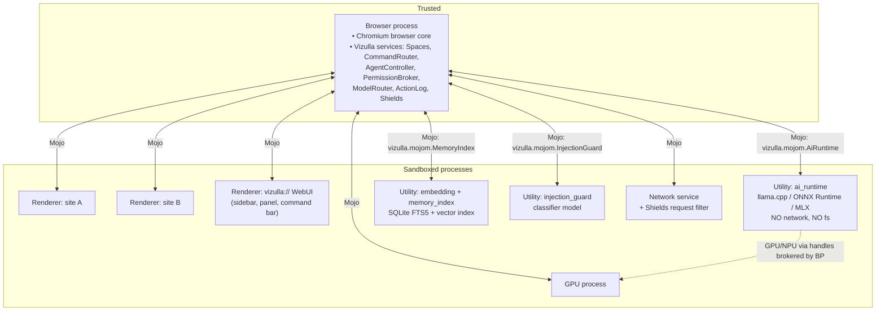
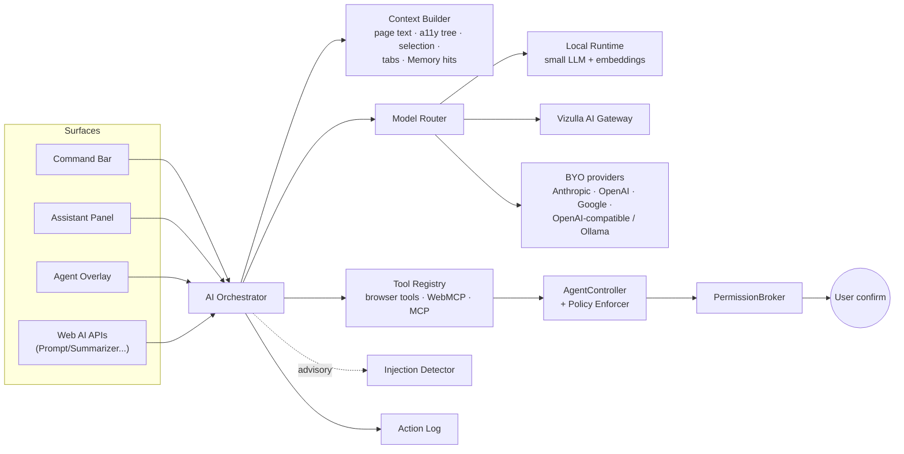
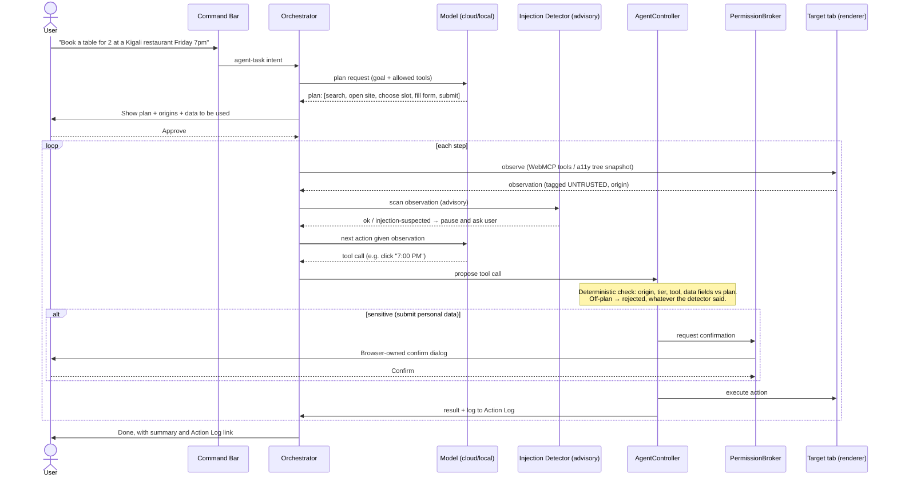
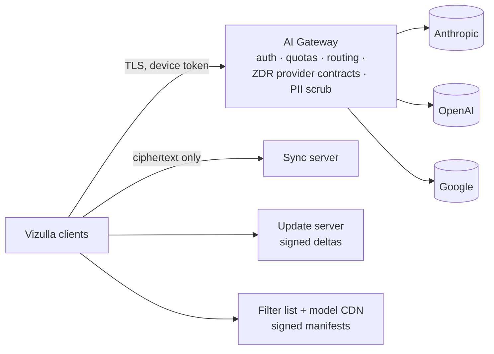

# 05 — Architecture & Big-Picture Prototype

This document describes how Vizulla is structured, from the process model down to the source tree, and gives a big-picture prototype of the UI and the main flows.

It describes the **target architecture** (after R3). Components arrive in stages. §12 lists which ones exist in R1, R2, and R3. The R1 browser has no bundled AI runtime, Memory, sync, or agent.

---

## 1. Architectural principles

1. **Upstream-first, overlay-always.** Chromium stays as close to unmodified as possible. Vizulla code lives in `vizulla/` and hooks in through a minimal set of patches.
2. **AI as a service, not a feature flag.** All inference and agent logic runs behind Mojo interfaces in separate, sandboxed processes.
3. **Lazy and unloadable.** No AI process, model, or index loads until it is first used, and all of them unload when idle.
4. **Browser owns trust.** The browser process alone makes security decisions (permissions, confirmations, credential fill, origin scope) using deterministic rules. Models only *propose*. Injection detection and trust labels are advisory signals, and no decision depends on them (ADR-011).
5. **Local first.** Default execution is on-device. Cloud execution is an explicit, visible routing decision.
6. **Web UI for chrome.** Browser UI surfaces are built with WebUI (TypeScript + Lit), so the team can move fast. Hot paths use native Views where profiling shows it is needed.

---

## 2. Layered view

```
┌───────────────────────────────────────────────────────────────────────────┐
│ PRESENTATION (WebUI + Views)                                              │
│  Sidebar/Spaces · Command Bar · Assistant Panel · Agent Overlay ·         │
│  Notes · Memory/Timeline · Privacy Dashboard · Settings · Onboarding      │
├───────────────────────────────────────────────────────────────────────────┤
│ VIZULLA BROWSER SERVICES (browser process, C++)                           │
│  SpacesService · TabLifecycleManager · CommandRouter · ShieldsService ·   │
│  MemoryService (broker) · AgentController · PermissionBroker ·            │
│  ActionLog · ModelRouter · ProviderRegistry · SyncBridge · PolicyService  │
├───────────────────────────────────────────────────────────────────────────┤
│ VIZULLA SANDBOXED SERVICES (utility processes, Mojo)                      │
│  ai_runtime (local inference) · embedding_service · memory_index (vector  │
│  + FTS) · content_extractor · injection_guard                             │
├───────────────────────────────────────────────────────────────────────────┤
│ CHROMIUM PLATFORM (unmodified where possible)                             │
│  //chrome · //content · Blink · V8 · Viz/Skia · network service ·         │
│  storage service · extensions · DevTools · PDF · password manager core    │
├───────────────────────────────────────────────────────────────────────────┤
│ OS / HARDWARE                                                             │
│  Windows · macOS · Linux · GPU · NPU · Keychain/DPAPI/libsecret           │
└───────────────────────────────────────────────────────────────────────────┘
          ▲                                    ▲
          │ HTTPS                              │ HTTPS
┌─────────┴───────────┐            ┌───────────┴────────────────────────┐
│ Vizulla Cloud        │            │ Third-party                         │
│ AI Gateway · Sync    │            │ LLM providers (BYO key) · MCP       │
│ (ciphertext) · Update│            │ servers · filter lists · threat intel│
│ · Filter list CDN    │            └─────────────────────────────────────┘
└─────────────────────┘
```

---

## 3. Process model



**Key isolation rules**
- `ai_runtime` gets model weights as **read-only file handles** from the browser process. It has no network access and no file-system access, and it is killed after 5 minutes idle.
- Cloud LLM calls go **from the browser process through the network service**, never from a renderer. Renderers (including WebUI) never see API keys. In R1 this is the only inference path, and `ai_runtime`, `memory_index`, and `injection_guard` do not exist yet.
- `memory_index` stores data in an encrypted SQLite database. The browser process holds the key, which comes from the OS keychain.
- Agents act on pages **only through `AgentController` in the browser process**, which sends actions to the target renderer through a dedicated `vizulla.mojom.AgentActuator` interface. The browser checks each action against the approved plan and origin scope.

---

## 4. AI subsystem

### 4.1 Components



| Component | Responsibility |
|---|---|
| **AI Orchestrator** | Runs requests from every surface: builds the prompt, runs the tool-use loop, streams the response. |
| **Context Builder** | Pulls readable text (a Readability-style extractor), the accessibility tree, selection, metadata, and multi-tab content. Labels every chunk with its **trust level** and **origin**. **Enforces the data access matrix** (doc 06 §5.2): it only gathers the sources the current capability tier allows. |
| **Model Router** | Picks local or cloud per request using a policy (below). In R1 it just follows the user's mode and provider. |
| **Tool Registry** | Browser-native tools (open tab, search, click, type, scroll, read, extract table, save note), WebMCP tools discovered on the page (behind a flag), and user-configured MCP servers (Later). Each tool declares its capability tier. |
| **Policy Enforcer** (in AgentController) | **Deterministic.** Checks every proposed tool call against the approved plan: origin, capability tier, tool, and data fields (AGT-11/12). Rejects anything outside it. This is the security boundary. |
| **Injection Detector** | **Advisory.** Scans untrusted content for instruction-like text, flags it to the model and the user, and can pause the agent (AGT-09). It cannot allow anything the Policy Enforcer would block. |
| **AgentController** | State machine for agent tasks: plan → approve → execute steps → checkpoint → finish or abort. Hosts the Policy Enforcer. |
| **PermissionBroker** | Shows browser-owned confirmation UI for sensitive actions and records grants with their scope and lifetime. |

### 4.2 Model routing policy

R1 routing is just `if AI off: reject; else: send to the user's chosen cloud provider or local OpenAI-compatible endpoint`, with the AI-05 disclosure. The full policy below arrives in R2 with the bundled runtime.

```
route(task):
  if user.mode == "AI off":                 reject
  if task.sensitivity == HIGH (vault, banking page, private window):
                                            LOCAL only (or refuse)
  if user.mode == "Local only":             LOCAL
  if task.kind in {intent, group_tabs, embed, classify, short_summary}:
                                            LOCAL
  if device.lacks_local_profile:            CLOUD (if permitted) else degrade
  if task.kind in {agent_plan, multi_tab_synthesis, long_doc_qa, code}:
                                            CLOUD (preferred provider)
  else:                                     LOCAL, escalate to CLOUD on low confidence
```

Suggested default cloud models are configurable. Example configuration for the Vizulla Gateway: `claude-sonnet-5-5` for agent planning and synthesis, and `claude-haiku-5-5` for fast cloud tasks. Users can switch to any supported provider or model.

### 4.3 Local runtime stack

| Concern | Choice |
|---|---|
| Inference engines | **One engine first**, chosen by spike S4 (doc 08 §3) from these candidates: **llama.cpp** (GGUF, portable, CPU/Metal/Vulkan/CUDA), **ONNX Runtime** with DirectML/Windows ML (Windows NPUs), and **MLX / Core ML** (Apple Silicon). A second engine is added only if benchmarks on RD-1/RD-3 show a clear gain for a supported platform. Each engine is a large, fast-moving C++ dependency inside the sandbox, so it needs fuzzing and update tracking like Chromium. |
| Fallback | If no accelerator is supported, CPU inference for small tasks (intent, embeddings). Summaries go to the cloud if the user allows it, otherwise they are disabled with a clear message. |
| Default LLM | ~3B-parameter permissively licensed instruct model, 4-bit quantized (~2 GB). Downloaded on demand after onboarding. |
| Embeddings | ~100–300M-parameter multilingual embedding model (~150–300 MB). |
| Injection classifier | Small fine-tuned classifier (~100M parameters). |
| Scheduling | One request queue with priorities (interactive > background indexing). Background indexing runs only when on AC power and idle. |

### 4.4 Agent execution loop



---

## 5. Data architecture

| Store | Release | Tech | Location | Encryption | Sync |
|---|---|---|---|---|---|
| History, bookmarks, cookies, etc. | R1 | Chromium native (SQLite / LevelDB) | Profile dir | OS-level + Chromium cookie encryption | E2EE (R2, optional) |
| Spaces & pins | R1 | SQLite (`vizulla_spaces.db`) | Profile dir | Profile key | E2EE (R2) |
| Memory: page text + embeddings | R2 | SQLite + FTS5 + vector extension (e.g. sqlite-vec) | Profile dir | SQLCipher-style, key in OS keychain | Later (opt-in E2EE) |
| Notes | R2 | SQLite + Markdown blobs | Profile dir | Profile key | E2EE |
| Action Log | R3 | Append-only SQLite, 30-day TTL | Profile dir | Profile key | No |
| Models | R2 | GGUF/ONNX files | Shared user data dir (read-only, hash-verified) | Signed manifests | No |
| API keys, vault keys | R1 | OS keychain / DPAPI / libsecret | OS | OS | Vault: E2EE (R2) |

Retention, deletion, backup, and uninstall behavior for each store are defined in **doc 06 §7** (PRV-06).

**Memory ingestion pipeline:**

```
page load complete → eligibility check (opt-in, not private, not excluded/sensitive)
 → content_extractor (main text, title, URL, timestamp)
 → chunk (≈ 512 tokens) → embedding_service → memory_index (vector + FTS)
 → (idle, AC power) optional local summary + tags
```

---

## 6. Shields design

- The request filter runs in the **network service** as a compiled Rust engine (the adblock-rust approach) for speed. It loads filter lists as a binary-serialized blob.
- Cosmetic filtering (element hiding) is injected through the content-script mechanism in renderers.
- Lists are fetched daily from the Vizulla CDN, signed, and verified before loading.
- A per-site exceptions store lives in the browser process.

---

## 7. Security architecture summary

(The full details are in doc 06.)

```
TRUST ZONES
┌──────────────────────────────────────────────┐
│ Zone 0  Browser process & browser-owned UI    │  decides, confirms, holds secrets
├──────────────────────────────────────────────┤
│ Zone 1  User instructions (Command Bar, panel)│  trusted intent
├──────────────────────────────────────────────┤
│ Zone 2  Model outputs                         │  proposals only: validated by Zone 0
├──────────────────────────────────────────────┤
│ Zone 3  Web content, PDFs, tool results       │  UNTRUSTED data, never instructions
└──────────────────────────────────────────────┘
```

---

## 8. UI prototype (wireframes)

### 8.1 Main window: Modern layout

```
┌──────────────────────────────────────────────────────────────────────────────────┐
│ ● ● ●                                                              ─  ▢  ✕       │
├──────────────┬───────────────────────────────────────────────┬───────────────────┤
│ ⌕ Ctrl+K     │ ◀ ▶ ⟳  🛡 12  │ docs.example.com/pricing       ✦ │ ✦ Assistant   ⋯ │
│──────────────│───────────────────────────────────────────────│  ◉ On device      │
│ SPACES       │                                               │───────────────────│
│ ◆ Work   ●   │                                               │ TL;DR             │
│ ◇ Study      │                                               │ • 3 plans: Free,  │
│ ◇ Personal   │                                               │   Pro $12, Team   │
│ + New space  │              WEB CONTENT                      │ • Annual saves 20%│
│──────────────│                                               │                   │
│ 📌 PINNED    │                                               │ Ask about page…   │
│  Mail        │                                               │ ┌───────────────┐ │
│  Calendar    │                                               │ │ Compare with  │ │
│──────────────│                                               │ │ the other 2   │ │
│ TABS         │                                               │ │ tabs ↵        │ │
│ ▾ Research ✦ │                                               │ └───────────────┘ │
│   Pricing ●  │                                               │                   │
│   Competitor │                                               │ [Summary][Q&A]    │
│   Review     │                                               │ [Notes][Agent]    │
│ ▸ Docs (4)   │                                               │                   │
│   Untitled   │                                               │                   │
│──────────────│                                               │                   │
│ 💤 3 asleep  │                                               │                   │
│ 🗄 Archive   │                                               │                   │
│ ⚙  🧠  📥    │                                               │                   │
└──────────────┴───────────────────────────────────────────────┴───────────────────┘
 ✦ = AI-generated group     🛡 12 = items blocked     ◉ = processing location
```

### 8.2 Command Bar (Ctrl/⌘+K)

```
┌──────────────────────────────────────────────────────────────┐
│ ✦  compare the laptops I looked at yesterday                 │
├──────────────────────────────────────────────────────────────┤
│ Interpreted as:  [Recall + Compare ✓]  [Search the web]      │
│──────────────────────────────────────────────────────────────│
│ 🧠 From Memory (yesterday)                                    │
│    Laptop A review · techsite.com                            │
│    Laptop B specs · maker.com                                │
│    Laptop C vs D · forum.com                                 │
│ ✦ Action: Open all 3 and build a comparison table   ↵        │
│ 🔍 Search "compare the laptops…"               Tab ⇥         │
└──────────────────────────────────────────────────────────────┘
```

### 8.3 Agent plan approval (browser-owned UI)

```
┌──────────────────────────────────────────────────────────────┐
│ 🤖 Task Agent: proposed plan                       ☁ Cloud   │
│──────────────────────────────────────────────────────────────│
│ Goal: Book a table for 2, Friday 7 PM, Kigali                │
│                                                              │
│ 1. Search restaurants with online booking                    │
│ 2. Open booking page on  restaurant-x.rw                     │
│ 3. Select Fri 7:00 PM, 2 guests                              │
│ 4. Fill name + phone  ⚠ uses your personal data             │
│ 5. Submit booking     ⚠ requires your confirmation          │
│                                                              │
│ Sites allowed: search provider, restaurant-x.rw              │
│ Session: ◉ Isolated agent session  ○ Use my logged-in session │
│                                                              │
│            [ Edit plan ]   [ Cancel ]   [ ▶ Run ]            │
└──────────────────────────────────────────────────────────────┘
```

### 8.4 Agent running overlay

```
┌───────────────────────────────────────────────────────────────┐
│ 🤖 Step 3/5: Selecting "7:00 PM"     ⏸ Pause  ✋ Take over  ⏹ │  ← pinned browser-owned bar
├───────────────────────────────────────────────────────────────┤
│                      web page                                 │
│              ┌─────────────┐                                  │
│              │  7:00 PM    │ ← highlighted target             │
│              └─────────────┘                                  │
└───────────────────────────────────────────────────────────────┘
```

---

## 9. Source tree (overlay layout)

```
vizulla-src/
├── src/                          # Upstream Chromium checkout (gclient), pinned to Stable tag
│   └── vizulla/                  # ← all Vizulla code (DEPS-managed, own git repo)
│       ├── BUILD.gn
│       ├── app/                  # branding, icons, installer, channel config
│       ├── browser/
│       │   ├── spaces/           # SpacesService, Space model, persistence
│       │   ├── tabs/             # TabLifecycleManager, auto-archive, predictive discard
│       │   ├── command_bar/      # CommandRouter, intent pipeline, suggestion providers
│       │   ├── ai/
│       │   │   ├── orchestrator/
│       │   │   ├── context/      # ContextBuilder, extractors, trust tagging
│       │   │   ├── router/       # ModelRouter, policies
│       │   │   ├── providers/    # gateway, anthropic, openai, google, openai_compat
│       │   │   ├── tools/        # browser tools, WebMCP bridge, MCP client
│       │   │   └── web_apis/     # Prompt/Summarizer/... API backends
│       │   ├── agent/            # AgentController, plan model, actuator host
│       │   ├── permissions/      # PermissionBroker, confirmation UI
│       │   ├── memory/           # MemoryService broker, ingestion policy
│       │   ├── shields/          # browser-side Shields settings & UI
│       │   ├── action_log/
│       │   ├── sync/             # E2EE sync bridge
│       │   └── ui/
│       │       ├── views/        # native Views (sidebar host, agent bar)
│       │       └── webui/        # vizulla:// page controllers
│       ├── components/
│       │   ├── ai_runtime/       # utility-process service (llama.cpp/ORT/MLX backends)
│       │   ├── memory_index/     # vector + FTS service
│       │   ├── injection_guard/
│       │   ├── content_extractor/
│       │   └── shields_engine/   # Rust adblock engine + network-service hook
│       ├── renderer/
│       │   └── agent_actuator/   # renderer-side action executor, a11y snapshot
│       ├── common/mojom/         # *.mojom interfaces
│       ├── resources/webui/      # TypeScript + Lit front-end for sidebar, panel, pages
│       ├── chromium_src/         # override shims (Brave-style) to minimize patches
│       ├── patches/              # small, numbered upstream patches (*.patch)
│       └── test/                 # unit, browser_tests, AI eval harness
├── tools/                        # build scripts, patch management, rebase helper
└── cloud/                        # (separate repo) AI Gateway, sync server, update server
```

### 9.1 Example Mojo interface

```mojom
// vizulla/common/mojom/ai_runtime.mojom
module vizulla.mojom;

enum TrustLevel { kUser, kBrowser, kUntrustedWeb, kToolResult };

struct ContextChunk {
  string text;
  TrustLevel trust;
  url.mojom.Origin? origin;
};

struct GenerateRequest {
  string task_kind;              // "summarize", "classify_intent", ...
  string system_instructions;    // browser-authored only
  array<ContextChunk> context;   // tagged; never merged into system text
  uint32 max_tokens;
};

interface GenerationClient {
  OnToken(string token);
  OnComplete(uint32 total_tokens);
  OnError(string reason);
};

interface AiRuntime {
  LoadModel(mojo_base.mojom.ReadOnlyFile weights, string model_id)
      => (bool ok);
  Generate(GenerateRequest req, pending_remote<GenerationClient> client);
  Embed(array<string> texts) => (array<array<float>> vectors);
  Unload();
};
```

---

## 10. Cloud side (minimal)



The Gateway is **stateless with respect to content**: it logs metering only, never prompts or outputs.

---

## 11. Build, release & CI

| Item | Approach |
|---|---|
| Build | GN + Ninja, with distributed compilation (Siso/RBE or a reclient-compatible backend). |
| Channels | Nightly → Beta → Stable, aligned to Chromium Stable + one week. |
| Rebase | Automated nightly trial rebase against upstream `main` to catch conflicts early. Release rebase onto each Stable tag. |
| Security merges | A dedicated "security sheriff" rotation. Watch upstream security releases and ship within 72 h (SEC-01). The full process, owners, and drills are in doc 08 §5. |
| Tests | Upstream test subsets + Vizulla `browser_tests` + WPT (M-WPT) + extension smoke (M-EXT) + AI eval gates + perf bots on RD-1/RD-2 (SRS §7.2). |
| Updates | Omaha-compatible updater on Windows/macOS (spike S7). APT/RPM/Flatpak on Linux from R2. |

---

## 12. Architecture by release

| Component | R1 | R2 | R3 |
|---|---|---|---|
| Chromium platform, branding, updater, importers | ✓ | + more importers | |
| Shields (network-service engine + cosmetic) | ✓ | + fingerprinting | |
| SpacesService, TabLifecycleManager, sidebar WebUI | ✓ | + predictive discard | |
| CommandRouter | Deterministic grammar | + on-device intent model | + agent-task route |
| AI Orchestrator + Context Builder (T0) | ✓ cloud only | + T0+ (multi-tab, Memory) | + agent tiers |
| ProviderRegistry (Gateway, BYO, OpenAI-compatible) | ✓ | | |
| Model Router (policy) | Mode only | ✓ full policy | |
| `ai_runtime` utility process | — | ✓ one engine | |
| `embedding_service` + `memory_index` | — | ✓ | |
| MemoryService, Notes | — | ✓ | |
| `injection_guard` (detector) | — (heuristics in the Context Builder only) | ✓ for Memory ingestion | ✓ for agent |
| SyncBridge + sync server | — | ✓ | |
| AgentController + Policy Enforcer, AgentActuator | — | — | ✓ |
| PermissionBroker (native confirmation UI) | ✓ (AI-05 disclosures) | ✓ (CMD-05) | ✓ (AGT-04) |
| Action Log | — | Commands + undo | ✓ full |
| WebMCP bridge | — | — | Flag |
| MCP client, built-in AI web APIs | — | — | Later |
