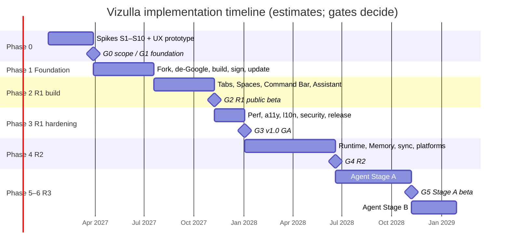

# 09 — Implementation Plan

**Audience:** Vizulla engineers (platform, browser features, AI, cloud, security, QA/release).
**Version:** 0.1 (Draft) · **Date:** 2026-11-07
**Builds on:** [SRS](../04-srs.md) (what), [Architecture](../05-architecture-prototype.md) (how it fits together), [Security model](../06-ai-security-privacy.md) (limits), [Roadmap](../07-roadmap-and-decisions.md) (when), [Validation plan](../08-validation-plan.md) (gates and spikes).

This plan turns the roadmap's phases into concrete engineering work: which Chromium pieces to reuse, which to extend, what to build from scratch, in what order, and how to know each piece is done.

---

## How to read this plan

| If you are… | Start with | Then |
|---|---|---|
| New to the team | [Engineering handbook](00-engineering-handbook.md) | The phase you are joining |
| Platform engineer | Handbook §1–5 | [Phase 0](phase-0-discovery.md), [Phase 1](phase-1-foundation.md) |
| Browser feature engineer | Handbook §6–8 | [Phase 2](phase-2-r1-build.md) |
| AI engineer | Handbook §7, §9 | Phase 2 §5–6, [Phase 4](phase-4-r2-memory-local-ai.md) |
| Cloud engineer | Handbook §10 | Phase 1 §6, Phase 2 §7 |
| Security engineer | [Security model](../06-ai-security-privacy.md) | Every phase's "Security" section, [Phases 5–6](phase-5-6-agent.md) |
| QA / release | Handbook §8, §11 | [Phase 3](phase-3-r1-hardening.md) |

### Files

| File | Covers |
|---|---|
| [00-engineering-handbook.md](00-engineering-handbook.md) | Repo layout, toolchain, `vz` CLI, build config, patch policy, Chromium integration patterns, Mojo/WebUI conventions, feature flags, testing, CI, code review |
| [phase-0-discovery.md](phase-0-discovery.md) | Weeks 1–12: spikes S1–S10, the throwaway UX prototype, design decisions |
| [phase-1-foundation.md](phase-1-foundation.md) | Months 4–7: fork, de-Googling, branding, build farm, signing, updater, Shields engine, importers, security process |
| [phase-2-r1-build.md](phase-2-r1-build.md) | Months 8–11: vertical tabs, Spaces, Command Bar, assistant panel, citations, Gateway, Privacy Dashboard → R1 beta |
| [phase-3-r1-hardening.md](phase-3-r1-hardening.md) | Months 12–13: performance, accessibility, localization, security, release → v1.0 |
| [phase-4-r2-memory-local-ai.md](phase-4-r2-memory-local-ai.md) | Months 14–19: ai_runtime, Model Router, Memory, Notes, multi-tab, sync, more platforms |
| [phase-5-6-agent.md](phase-5-6-agent.md) | Months 20–27+: Agent Stage A (isolated session) and Stage B (personal data, commit actions) |

---

## 1. The plan on one page

The start date is a placeholder. Every duration is an estimate from the [roadmap](../07-roadmap-and-decisions.md#2-phased-plan). A gate that fails changes the plan.

### What gets built, layer by layer

| Layer | Reuse from Chromium | Extend (overlay + small patches) | Build new |
|---|---|---|---|
| Engine | Blink, V8, network service, GPU/Viz, site isolation, sandbox | — | — |
| Browser core | Profiles, sessions, downloads, PDF, DevTools, extensions, password manager, passkeys | Branding, Google-service removal, component updater endpoint, variations seed, Safe Browsing backend | Importers for Chrome/Arc |
| Tabs | `TabStripModel`, tab lifecycle (discard/freeze), saved tab groups | Vertical tab region in `BrowserView`, Space filtering | `SpacesService`, auto-archive |
| Address bar | `AutocompleteController` + providers | Command Bar view replacing `LocationBarView` | Command grammar, command palette provider |
| Side panel | Side panel framework | Vizulla panel entries | Assistant WebUI |
| Content blocking | `URLLoaderFactory` proxy hook (as used by the extensions webRequest API) | Hook registration | Rust filter engine bridge, cosmetic filter injector |
| AI (R1) | `SimpleURLLoader` streaming, `os_crypt`, accessibility tree snapshots, text fragments | — | Orchestrator, Context Builder, provider adapters, citations |
| AI (R2) | Utility process hosting, the on-device model service pattern | Sandbox policy for GPU inference | `ai_runtime`, `memory_index`, Model Router |
| Agent (R3) | Accessibility actions, off-the-record profiles, input injection | Network egress filter for agent tabs | AgentController, Policy Enforcer, PermissionBroker UI |
| Cloud | — | — | AI Gateway, update server, sync server, filter-list/model CDN, crash server |

**Rule of thumb:** reuse first, extend second, build last. Every "build new" item above exists because upstream has nothing usable.

---

## 2. Workstreams and team

| Code | Workstream | People | Owns |
|---|---|---|---|
| **PLT** | Chromium platform | 3 | Checkout, build, patches, rebases, security merges, de-Googling, updater, packaging |
| **BRW** | Browser features | 4 | Tabs, Spaces, Command Bar, side panels, Shields UI, settings, Classic mode, importers |
| **AI** | AI & ML | 3 | Orchestrator, Context Builder, providers, citations, evals, runtime, Memory, agent logic |
| **SEC** | Security | 1–2 | Threat model, sandbox policies, Policy Enforcer review, bug bounty, red team |
| **CLD** | Cloud | 2 | Gateway, update server, filter/model CDN, sync, crash and telemetry endpoints |
| **REL** | QA & release | 2 | CI, perf bots, reference device lab, release trains, signing |
| **UX** | Design | 2 | Prototype study, UI specs, accessibility, localization |
| **PM** | Product | 1 | Scope, decisions register, acceptance |

Fork maintenance takes most of PLT (2.5–3.5 FTE, [roadmap §6.1](../07-roadmap-and-decisions.md#61-capacity-check)). **Feature work never borrows PLT time.** If BRW needs a patch, BRW writes it and PLT reviews it.

---

## 3. Task conventions

### 3.1 Task IDs

`P<phase>-<WORKSTREAM>-<NN>`, e.g. `P2-BRW-07`. Each task in this plan becomes a ticket with the same ID. A task lists:

| Field | Meaning |
|---|---|
| **Depends** | Task IDs or decisions that must be done first |
| **Est.** | Rough engineer-weeks (ew). These are planning numbers to be re-estimated in sprint planning, not commitments. |
| **SRS** | Requirement IDs the task delivers |
| **Done when** | Task-specific acceptance, on top of the Definition of Done below |

### 3.2 Definition of Done (every task)

- [ ] Code lives in `src/vizulla/`. Any upstream change is a `chromium_src/` override or a numbered patch with an approved patch-budget entry ([handbook §4](00-engineering-handbook.md#4-patch-policy)).
- [ ] Behind a `base::Feature` until its release gate ([handbook §7](00-engineering-handbook.md#7-feature-flags)).
- [ ] Unit tests. Browser tests for UI or cross-process behavior. AI eval cases for AI behavior.
- [ ] Accessible: keyboard path, screen reader names/roles, focus order, high-contrast check.
- [ ] Strings in `.grd` resources (no hard-coded UI text). RTL layout checked.
- [ ] No new perf regression on the perf bots (PERF-02/05 budgets).
- [ ] Security-relevant code (IPC, parsing, anything handling untrusted data or secrets) reviewed by SEC.
- [ ] The SRS requirement's ticket links to the verification artifact.

### 3.3 Sprints

Two-week sprints. Each phase file lists its work as **milestones** (M-labels) grouped by sprint range, so teams can plan in parallel. Demo every sprint on a Nightly build, not a developer build.

---

## 4. Design decisions introduced by this plan

The architecture docs leave some implementation choices open. These are settled in Phase 0 by the spike named, and recorded as ADRs in the [roadmap](../07-roadmap-and-decisions.md#4-architecture-decision-records).

| ID | Question | Recommendation | Decided by |
|---|---|---|---|
| **DD-1** | How are Spaces modeled on top of `TabStripModel`? | One `TabStripModel` per window. Tabs from inactive Spaces stay in the model but are hidden from the strip and skipped by tab-cycling commands. Extensions keep seeing every tab. | S5 prototype ([Phase 0 §3](phase-0-discovery.md)) |
| **DD-2** | Vertical tab list: WebUI or native Views? | **Native Views** for the tab list (drag-and-drop, hundreds of rows, accessibility, startup time). WebUI for the Space switcher footer, archive, and panels. This amends ADR-006 (proposed ADR-012). | S5 |
| **DD-3** | Where does the Shields request filter run? | **In the browser process**, through a `URLLoaderFactory` proxy (the same hook the extensions webRequest API uses), calling the Rust engine on a thread pool. Move into the network service only if profiling shows IPC cost. This amends ADR-007 (proposed ADR-013). | Phase 1 benchmark |
| **DD-4** | What does the assistant read: DOM text or the accessibility tree? | **The accessibility tree snapshot.** One path covers HTML and PDF. It carries node IDs that citations can point back to, and it reflects what users can actually see. | S5 + Phase 2 prototype |
| **DD-5** | How are citations shown? | Answers cite chunk IDs → the browser maps them to AX nodes → it scrolls and highlights using text fragments (`#:~:text=`) for HTML and PDF search-and-highlight for PDFs. | Phase 2 |
| **DD-6** | Is `vizulla://` a real scheme? | No. Keep `chrome://` internally and rewrite the display and input form to `vizulla://` (the approach Brave uses for `brave://`). This avoids deep scheme patches. | Phase 1 |
| **DD-7** | Updater | Brand Chromium's cross-platform updater (`//chrome/updater`, Omaha 4 protocol) if spike S7 shows it can be pointed at our server. Otherwise Omaha 3 on Windows + Sparkle on macOS. | S7 |
| **DD-8** | Memory vector index | A flat int8-quantized index in the `memory_index` service, with FTS handled by Chromium's `//sql`. No SQLite extension loading. 50k pages × 384 dims ≈ 19 MB, and a brute-force SIMD scan fits PERF-08. | Phase 4 spike |
| **DD-9** | Memory encryption at rest | An encrypting SQLite VFS shim with the key from the OS keychain. Chromium's `//sql` does not ship SQLCipher, and FTS cannot run over row-level encrypted text. | Phase 4 spike + SEC review |
| **DD-10** | Agent Session isolation | A dedicated non-primary **off-the-record profile** per agent task (the same mechanism DevTools uses for isolated browser contexts), destroyed at the end of the task. | Phase 5 |
| **DD-11** | Agent actuation | Accessibility actions first (`ui::AXActionData`: do-default, set-value, focus, scroll-into-view), then trusted input events at an AX node's bounds. No custom script injection into pages. | Phase 5 |
| **DD-12** | Gateway / cloud language | **Go** for the Gateway, update server, and sync server (streaming proxies, small static binaries). TypeScript is shared only between WebUI code and tests. | Phase 0 (CLD) |

Chromium APIs change between milestones. Class and function names here are correct as of this writing, but check them against the pinned tag before relying on them.

---

## 5. Cross-phase checklists

**Before a phase starts:** the previous gate passed, owners named, tickets created from the phase file, budgets set (perf, patch count, cloud cost).

**Before a phase ends:** the gate evidence is collected ([validation plan §1](../08-validation-plan.md#1-gates)), the SRS traceability report is generated, a retro is held, and this plan is updated with what actually happened.
