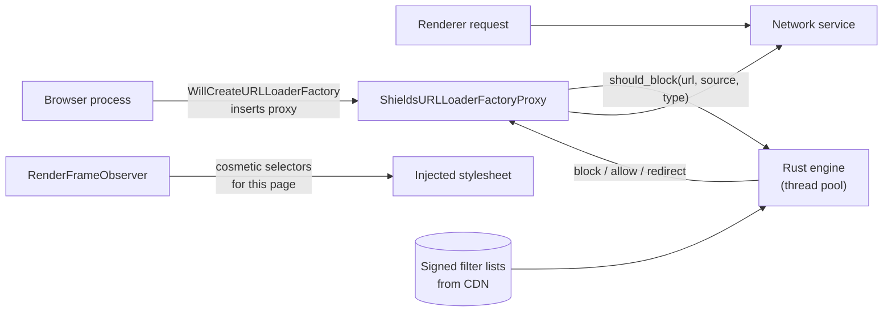

# Phase 1 — Foundation (months 4–7, ~16 weeks)

**Goal:** a real, branded, signed, auto-updating Chromium browser with no Google-service dependencies, native Shields, and importers. It looks like a plain browser (no modern UI yet), but it is something we could ship securely.
**Assumes:** G1 chose F1 (full fork) or F2 (narrow fork). For F2, skip the tasks marked *(F1 only)* and build R1 UI features as a component extension in Phase 2.
**Exit:** daily Nightly on R1 platforms · two Stable rebases done in ≤ 5 working days each · a security drill passed on production infrastructure · Shields passes its tests.

---

## 1. Milestones

| Sprints | Milestone | Demo |
|---|---|---|
| 1–2 | **M1.1 Production workspace** | `vz` CLI v1, RBE, PR CI green on 3 OSes |
| 3–4 | **M1.2 Clean browser** | Branded build with every Google service removed or replaced, `vizulla://` URLs |
| 5–6 | **M1.3 Shippable** | Signed installers, updater talking to our server, crash reporting (opt-in) |
| 7–8 | **M1.4 Shields + import + security process** | Ads blocked, Chrome/Firefox/Safari/Edge import, a 72 h drill on production infra → **Phase 1 exit** |

---

## 2. Build & tooling (PLT, REL)

| ID | Task | Depends | Est. | SRS | Done when |
|---|---|---|---|---|---|
| P1-PLT-01 | **`vz` CLI v1**: init, sync, patch apply/update/lint, gen presets, build, test, run, rebase (3-way, per-patch report), doctor. Docs in the handbook. | Phase 0 scripts | 3 ew | MNT-01/02 | A new engineer builds in one day from the handbook |
| P1-PLT-02 | **Repo structure**: `vizulla-core` layout (handbook §1), `OWNERS`, `BUILD.gn` targets `vizulla` (browser), `vizulla_unittests`, `vizulla_browser_tests`, `vizulla_interactive_ui_tests` | 01 | 1 ew | MNT-04 | Targets build and run in CI |
| P1-PLT-03 | **`chromium_src/` redirect mechanism**: the compiler wrapper (or GN source-swap) that substitutes override files, plus `vz` checks that every override's original still exists after a rebase | 01 | 2 ew | MNT-01 | An override demo builds. A missing original fails loudly. |
| P1-PLT-04 | **Production RBE + cache** from the Phase 0 trial: auth, cache eviction policy, cost dashboard | P0-PLT-04 | 2 ew | — | Incremental < 5 min. Clean from cache < 30 min. |
| P1-REL-01 | **CI tiers** (handbook §11.1) on self-hosted runners: PR, Nightly, Release pipelines. Test sharding. A flaky-test quarantine bot. | 02, 04 | 4 ew | MNT-03 | PR tier ≤ 45 min. Nightly publishes builds. |
| P1-REL-02 | **Perf bots** on RD-1/RD-2: M-START, M-IDLE, M-W30, M-JS, M-BATT scripts (crossbench, memory-infra, WPR) against the upstream Chromium baseline and Google Chrome | P0-REL-02 | 4 ew | PERF-01..04, 10 | Nightly dashboard with regression alerts (> 3%) |
| P1-REL-03 | **WPT + extension harness** in Nightly: M-WPT diff against upstream at the same tag, and M-EXT on the frozen top-100 list | 01 | 3 ew | CORE-01, EXT-01 | Reports published nightly |

---

## 3. A clean, branded browser (PLT, BRW)

| ID | Task | Depends | Est. | SRS | Done when |
|---|---|---|---|---|---|
| P1-PLT-05 | **Branding**: product name, icons (all sizes, platform formats), `BRANDING`, installer strings, the user-data-dir name (`Vizulla`), protocol handler registration, default-browser flows | P1-PLT-02 | 2 ew | CORE-10 | No "Chromium" text in the UI, except the "About" attribution |
| P1-PLT-06 | **De-Google: services** (from P0-PLT-07): remove the Google sync UI and endpoints, sign-in promos, GCM, translate server, Optimization Guide remote fetches, NTP Google services, spellcheck dictionary URL → our CDN | 05 | 3 ew | C4 | Network log of a fresh profile shows no Google endpoints (except sites the user visits and any licensed services) |
| P1-PLT-07 | **Component updater → our server**: serve CRLSets, CT log lists, and other security components from our own server (mirrored with integrity checks or licensed). Disable components we don't need. | 06 | 3 ew | SEC-06 | CRLSet updates verified end to end |
| P1-PLT-08 | **Variations seed server**: point upstream variations at our signed seed on the CDN (feature kill switches, staged rollout) | 06 | 1.5 ew | — | A feature can be disabled remotely in Nightly |
| P1-PLT-09 | **Codecs & DRM**: `proprietary_codecs` decision with legal (H.264/AAC licensing). Widevine CDM integration as soon as the license arrives (component delivery + signing). | Legal, license | 2 ew | — | Netflix-class test site plays (if licensed). Fallback messaging if not. |
| P1-SEC-01 | **Safe Browsing replacement** (D-8): implement the vendor-backed URL checking behind upstream's Safe Browsing interfaces (a database manager / URL checker delegate). Keep upstream's local download protection. Interstitials keep the upstream UI. | P0-SEC-01, contract | 4 ew | ID-04 | Test phishing/malware URLs from the vendor are blocked. Latency p95 < 50 ms. |
| P1-SEC-02 | **Password leak check replacement**: disable Google leak detection. Implement a k-anonymity check against the chosen provider (hash prefix only leaves the device). | P0-SEC-01 | 2 ew | ID-01 | Known-breached test credential flagged. Network capture shows only the hash prefix. |
| P1-BRW-01 | **`vizulla://` display scheme** (DD-6): a `BrowserURLHandler` rewriter mapping `vizulla://x` ↔ `chrome://x` for input and display | 05 | 1 ew | UI-3 | `vizulla://settings` typed, shown, and bookmarked correctly |

---

## 4. Ship and update (REL, PLT, CLD)

| ID | Task | Depends | Est. | SRS | Done when |
|---|---|---|---|---|---|
| P1-REL-04 | **Production signing**: Windows Authenticode with the EV cert in an HSM/cloud KMS, macOS Developer ID + notarization + stapling, a GPG key for the Linux nightly. Signing runs only in the Release pipeline. | P0-REL-01 | 2 ew | SEC-06 | Signed builds pass SmartScreen and Gatekeeper on clean machines |
| P1-REL-05 | **Installers**: Windows (per-user and per-machine, with the updater), macOS DMG/PKG, Linux `.deb`/`.rpm` (nightly only) | 04 | 3 ew | — | Install, uninstall, upgrade, and downgrade tests pass |
| P1-PLT-10 | **Updater** (DD-7): branded updater, staged rollout percentages, channel switching, rollback | P0-PLT-06 | 3 ew | SEC-01 | Nightly auto-updates daily on all R1 platforms |
| P1-CLD-01 | **Update server + CDN**: Omaha endpoint, signed manifests, staged-rollout control, rollback switch | — | 3 ew | SEC-06 | Serves Nightly. Rollback demo. |
| P1-CLD-02 | **Crash ingest** (opt-in): Crashpad upload endpoint, symbol server, symbolication, dashboards | — | 2 ew | REL-01 | A crash in Nightly appears symbolicated within 15 min |
| P1-PLT-11 | **Opt-in telemetry client**: a minimal, aggregated metrics path (no URLs, no content), with the consent UI. Upstream UMA is disabled. | 06 | 2 ew | PRV-01 | Privacy review passes. Off by default. |

---

## 5. Shields engine (BRW + PLT, with SEC review)

| ID | Task | Depends | Est. | SRS | Done when |
|---|---|---|---|---|---|
| P1-BRW-02 | **Rust engine integration**: build the filter engine crate (adblock-rust or equivalent; license review for MPL-2.0) as a `rust_static_library`, with a C++ bridge (`cxx`). APIs: load the serialized engine, `Check(url, source_url, request_type)`, `GetCosmetic(url)`. | P1-PLT-02 | 3 ew | SHD-01 | Unit tests on the EasyList test suite. Fuzzer on list parsing. |
| P1-BRW-03 | **Request blocking** (DD-3): the `ShieldsURLLoaderFactoryProxy` installed through `WillCreateURLLoaderFactory` for frame, subresource, and service-worker requests. Honors per-site exceptions. Counts blocks per tab. | 02 | 4 ew | SHD-01/02 | W30 runs with Shields on. Median Check() < 0.1 ms. No WPT regressions. |
| P1-BRW-04 | **Cosmetic filtering**: renderer-side `RenderFrameObserver` that asks the browser for selectors per frame and injects a stylesheet early. Generic hiding + site-specific rules. | 02 | 3 ew | SHD-01 | Cosmetic rules work on the site-compat list without layout jank |
| P1-CLD-03 | **Filter-list pipeline**: fetch upstream lists daily, compile them into a serialized engine, sign (ed25519), publish to the CDN. The client verifies the signature and swaps atomically. | — | 2 ew | SHD-01 | Client updates lists daily. A tampered blob is rejected. |
| P1-BRW-05 | **3rd-party cookie blocking, HTTPS-First, DoH defaults**: mostly upstream settings with Vizulla defaults + settings UI | P1-PLT-05 | 1.5 ew | SHD-04/05/06 | Defaults verified in a fresh profile |
| P1-BRW-06 | **Shields UI**: toolbar shield with blocked count, per-site panel (toggle, counts by category), a settings section | 03 | 2 ew | SHD-02 | Keyboard- and screen-reader-accessible. Counts match the engine. |

**Benchmark for DD-3:** measure the added latency per request and the browser-process CPU on W30. If the proxy adds more than 1 ms p95 per request or shows up in startup traces, plan the move into the network service for R2.

---

## 6. Import (BRW)

| ID | Task | Depends | Est. | SRS | Done when |
|---|---|---|---|---|---|
| P1-BRW-07 | **Firefox, Safari, Edge**: reuse upstream importers. Check each still works on current versions of those browsers. | P1-PLT-05 | 1.5 ew | SYN-03 | Bookmarks, history, and passwords (where upstream supports them) imported |
| P1-BRW-08 | **Chrome importer** (not upstream): read the other browser's profile (`Bookmarks` JSON, `History` SQLite, open tabs from session files). Passwords: on macOS, decrypt with the "Chrome Safe Storage" keychain item (the user approves a keychain prompt). On Windows, Chrome's **app-bound encryption** blocks other apps from decrypting cookies and possibly passwords, so offer a guided CSV export → import instead. | 07 | 4 ew | SYN-03 | Import works on Chrome Stable on Win/mac. The CSV path is tested. |
| P1-BRW-09 | **Import UI** (first-run step + settings): choose a browser and profile, pick data types, see progress and results | 07 | 1.5 ew | SYN-03 | Usable with keyboard and screen reader |

Extensions are not imported directly. Show the list of the user's extensions with "Install from Chrome Web Store" links (Phase 2 onboarding).

---

## 7. Security process goes live (PLT, SEC, REL)

| ID | Task | Depends | Est. | Done when |
|---|---|---|---|---|
| P1-SEC-03 | **Security sheriff rotation** ([validation plan §5](../08-validation-plan.md#5-chromium-update--security-process-operational-readiness)): a feed watcher on upstream Chrome Releases and security advisories that pages the on-call sheriff. Runbook. Escalation path. | P1-REL-01 | 1.5 ew | The runbook is used in a drill |
| P1-SEC-04 | **Production drill**: the full 72 h path on production signing + updater + CDN, to the Nightly and a hidden Stable-test channel | P1-REL-04, P1-PLT-10, P1-CLD-01 | 1 ew | ≤ 72 h, with a timeline published internally |
| P1-PLT-12 | **Stable rebases ×2 in Phase 1**, measured against MNT-02. Patch-budget report per rebase. | P1-PLT-01 | 2 × 1.5 ew | ≤ 5 working days each |
| P1-SEC-05 | **SBOM generation** in the Release pipeline (upstream `third_party` + Vizulla deps + Rust crates) | P1-REL-01 | 1 ew | SBOM attached to every release (SEC-08) |

---

## 8. Exit checklist

- [ ] Nightly auto-updates daily on Windows x64 and macOS Apple Silicon. Linux nightly builds.
- [ ] Fresh-profile network log: no unlicensed Google endpoints.
- [ ] CRLSet and other security components update from our server.
- [ ] Shields blocks ads/trackers on W30. No WPT regressions vs upstream.
- [ ] Import from Chrome, Edge, Firefox, Safari works on R1 platforms.
- [ ] Two Stable rebases ≤ 5 working days each. Patch budget respected.
- [ ] 72 h security drill passed on production infrastructure.
- [ ] Perf bots show PERF-02 and PERF-04 within targets for the plain browser (the baseline before UI work).
