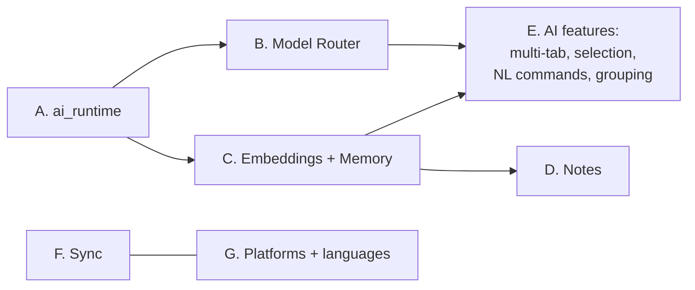
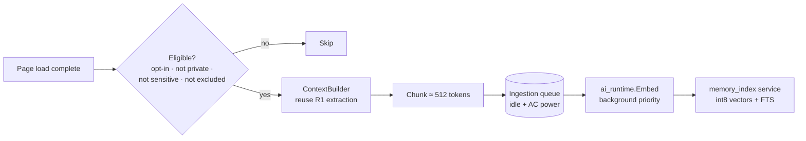

# Phase 4 — R2: Memory + Local AI (months 14–19, ~24 weeks)

**Goal:** on-device inference, Memory (opt-in), Notes, multi-tab synthesis, selected-text actions, natural-language commands, E2EE sync, and the remaining platforms and languages.
**Exit:** Gate **G4** ([SRS §7.1](../04-srs.md#71-verification-methods)): every R2 requirement verified, PERF-06/08/09 met, Memory DPIA signed off.
**Team:** AI (3) on the runtime, router, and Memory · BRW (4) on UI, commands, sync UI, platform features · CLD (2) on the sync server and model CDN · PLT on platforms, sandboxing, rebases · SEC on the runtime sandbox and Memory review.

The work splits into **seven tracks** that can run in parallel after the runtime lands.



---

## 1. Milestones

| Sprints | Milestone | Demo |
|---|---|---|
| 1–3 | **M4.1 Runtime** | Sandboxed `ai_runtime` runs the default model on RD-1/RD-3. The model is downloaded, verified, loaded, and unloaded. |
| 3–5 | **M4.2 Router + local assistant** | Summaries run on device. The badge shows "On device". Escalation to the cloud on low confidence. |
| 4–7 | **M4.3 Memory** | Opt-in indexing, recall in the Command Bar, Save to Memory, and the management page |
| 6–9 | **M4.4 AI features** | Multi-tab synthesis, selection actions, NL commands, AI tab grouping, Ask Settings, Notes |
| 5–10 | **M4.5 Sync** | E2EE sync of tabs, Spaces, bookmarks, history, passwords, and settings between two devices |
| 4–11 | **M4.6 Platforms + languages** | Windows ARM64, macOS Intel, Linux Stable. Kinyarwanda and Swahili UI. |
| 11–12 | **M4.7 R2 hardening** → **G4** | |

---

## 2. Track A — `ai_runtime` (AI + PLT + SEC)

### 2.1 Process and interface

- Launched with `content::ServiceProcessHost::Launch<vizulla::mojom::AiRuntime>()` in its own utility process, with a sandbox type that allows GPU access only (the policy comes from the P3-PLT-01 spike). No network, no file-system access (SEC-02).
- **One engine** (D-6), compiled into the service. Model weights arrive as read-only file handles opened by the browser process.
- Lazy start on the first request. Unload after 5 min idle or on memory pressure (AI-08). Restart within 2 s after a crash, retrying the request once (REL-02).

```mojom
// additions to vizulla/common/mojom/ai_runtime.mojom (see doc 05 §9.1)
struct ModelInfo { string model_id; string sha256; uint64 size_bytes; ModelKind kind; };
enum ModelKind { kGenerate, kEmbed, kClassify };
enum Priority { kInteractive, kBackground };

interface AiRuntime {
  LoadModel(mojo_base.mojom.ReadOnlyFile weights, ModelInfo info) => (LoadResult result);
  Generate(GenerateRequest req, Priority priority, pending_remote<GenerationClient> client);
  Embed(array<string> texts, Priority priority) => (array<array<float>> vectors);
  Classify(string text, string label_set_id) => (array<LabelScore> scores);
  GetStatus() => (RuntimeStatus status);   // loaded models, memory use, queue depth
  Unload();
};
```

### 2.2 Model manager (browser process)

```json
// Signed manifest served from the model CDN (ed25519), cached locally
{
  "manifest_version": 1,
  "models": [{
    "id": "vz-gen-3b-q4-2027-05",
    "kind": "generate",
    "engine": "<D-6 engine>",
    "url": "https://models.vizulla.example/vz-gen-3b-q4-2027-05.bin",
    "sha256": "…", "size_bytes": 2100000000,
    "min_profile": "RD-3", "license": "Apache-2.0",
    "languages": ["en", "fr", "sw", "rw"]
  }]
}
```

### 2.3 Tasks

| ID | Task | Depends | Est. | SRS | Done when |
|---|---|---|---|---|---|
| P4-AI-01 | **Runtime service**: engine integration, the Mojo interface, a priority queue (interactive over background), cancellation, streaming tokens | D-6, P3-PLT-01 | 6 ew | AI-01, SEC-02 | Runs under the strict sandbox on Win/mac. Sandbox escape tests pass. |
| P4-AI-02 | **Model manager**: manifest fetch and signature check, resumable downloads (only on unmetered networks unless the user allows otherwise), hash verification, disk-space checks, removal, and the 90-day "unused" prompt | — | 3 ew | AI-02, doc 06 §7 | A tampered model is rejected. Low-disk path tested. |
| P4-AI-03 | **Device capability profile**: detect RAM, GPU/NPU, and driver support. Decide whether the device meets the "local AI profile". Re-check after driver updates. | 01 | 1.5 ew | AI-04 | Correct on the RD lab devices |
| P4-AI-04 | **Lifecycle**: idle unload, memory-pressure unload, crash restart + retry, and `GetStatus` shown in the task manager | 01 | 2 ew | AI-08, REL-02, PERF-09 | Memory returns to baseline within 10 s of unload |
| P4-SEC-01 | **Fuzz the model file parser** and the tokenizer. Treat model files as untrusted input even when signed. | 01 | 2 ew | C12 | Continuous fuzzing on |

---

## 3. Track B — Model Router (AI)

Implements the routing policy in [doc 05 §4.2](../05-architecture-prototype.md#42-model-routing-policy).

| ID | Task | Depends | Est. | SRS | Done when |
|---|---|---|---|---|---|
| P4-AI-05 | **`ModelRouter`**: policy inputs (user mode, task kind, device profile, sensitivity), outputs (local / cloud / refuse / degrade), and a log line for every decision (shown in the Privacy Dashboard) | A | 2 ew | AI-04 | A table-driven test of every combination |
| P4-AI-06 | **Escalation**: a local answer with low confidence (judged by a small verifier prompt or by citation validation) offers "Ask cloud model" if the mode allows it. Never automatic in Local-only mode. | 05 | 2 ew | AI-04/05 | An eval shows the quality gain. The disclosure is respected. |
| P4-AI-07 | **Local prompts** tuned for the small model, with separate eval baselines | 05 | 3 ew | AIQ-01 | Meets AIQ-01 on the tasks routed locally |

---

## 4. Track C — Memory (AI + BRW + SEC)

### 4.1 Pipeline



Sensitive-category detection (MEM-02) runs locally: the URL category list plus on-device classification of the page title and domain. It defaults to **skip** when unsure.

### 4.2 Storage (DD-8, DD-9)

```sql
-- memory.db, in the profile dir, opened through the encrypting VFS (DD-9)
CREATE TABLE items (
  id INTEGER PRIMARY KEY, kind TEXT NOT NULL,            -- 'visit' | 'save' | 'note' | 'download'
  url TEXT, origin TEXT NOT NULL, title TEXT,
  visited_at INTEGER NOT NULL, saved INTEGER NOT NULL DEFAULT 0,
  summary TEXT, tags TEXT, expires_at INTEGER);
CREATE TABLE chunks (
  id INTEGER PRIMARY KEY, item_id INTEGER NOT NULL REFERENCES items(id) ON DELETE CASCADE,
  ord INTEGER NOT NULL, text TEXT NOT NULL);
CREATE VIRTUAL TABLE chunks_fts USING fts5(text, content='chunks', content_rowid='id');
-- Vectors live in a separate encrypted file managed by memory_index:
-- a flat int8 array [chunk_id → 384 dims] + a tombstone bitmap, compacted when idle.
```

Check that FTS5 is enabled in Chromium's SQLite build at the pinned tag. If it is not, enabling it is a small build-config patch.

**Recall query:** hybrid ranking = BM25 (FTS) + cosine (vectors) + a time-decay term, with filters parsed from the query ("yesterday", "on youtube") by the local model. Results show the title, origin, time, and the matching passage.

### 4.3 Tasks

| ID | Task | Depends | Est. | SRS | Done when |
|---|---|---|---|---|---|
| P4-AI-08 | **`memory_index` service** (utility process): the vector store (DD-8), FTS queries, hybrid ranking, compaction, deletion | A | 5 ew | MEM-01/03, PERF-08 | ≤ 200 ms p95 over 50k pages on RD-1. Recall@10 measured. |
| P4-SEC-02 | **Encrypting VFS** (DD-9): AES-GCM per page, the key in the OS keychain, key rotation and wipe | P3 spike | 3 ew | MEM-01, PRV-03 | SEC review passes. A copied DB file is unreadable on another device. |
| P4-AI-09 | **`MemoryService`** (browser, `KeyedService`): opt-in state, eligibility rules, the ingestion queue (idle + AC), history-deletion hooks (deleting history deletes the Memory item), expiry | 08 | 4 ew | MEM-01/02/07 | Deletion completes within 24 h, incl. vectors (doc 06 §7) |
| P4-BRW-01 | **Recall in the Command Bar**: a `MemoryRecallProvider` for the autocomplete pipeline, shown in a separate section | 09 | 2 ew | MEM-03, CMD-04 | USE-02 R2 task ≥ 85% |
| P4-BRW-02 | **Save to Memory** (button + shortcut), auto-tags and summary from the local model. Works alongside classic bookmarks (a saved item can also be a bookmark). | 09 | 2 ew | MEM-05 | — |
| P4-BRW-03 | **`vizulla://memory`** management page: search, filter by site/time, edit, delete, delete by site or time range, wipe all, the opt-in switch, the exclusion list | 09 | 3 ew | MEM-07 | Accessible. "Wipe all" verified on disk. |
| P4-SEC-03 | **Memory DPIA** + memory-poisoning tests (TH-6): stored text is always injected as untrusted data | 09 | 1.5 ew | PRV-04 | DPIA signed |

---

## 5. Track D — Notes (BRW)

| ID | Task | Est. | SRS | Done when |
|---|---|---|---|---|
| P4-BRW-04 | **Notes panel** (side panel WebUI): clip a selection with its source link, rich text editor (a small, audited editor with Markdown storage), link to the page and Space, Markdown export | 4 ew | MEM-06 | Clipping keeps the source link and a text fragment back to the passage |
| P4-BRW-05 | **Send AI output to Notes** from the assistant panel | 1 ew | PA-09 | — |

---

## 6. Track E — AI features (AI + BRW)

| ID | Task | Depends | Est. | SRS | Done when |
|---|---|---|---|---|---|
| P4-AI-10 | **Multi-tab context (T0+)**: tab picker (up to 20), ContextBuilder over selected tabs only, a per-tab token budget, citations that point to a tab + passage, table output | B | 4 ew | PA-05 | Eval set for comparisons. Citations open the right tab. |
| P4-AI-11 | **Selected-text actions**: context menu + a floating mini-toolbar (explain, simplify, translate, define, rewrite, proofread) | B | 3 ew | PA-03 | Works in editable fields and PDFs |
| P4-AI-12 | **On-device intent classifier** for the Command Bar: a small classifier model, labels per CMD-02 R2, the chips UI below 0.7 confidence. The deterministic URL route always wins. | A | 3 ew | CMD-02/03, AIQ-04 | ≤ 30 ms p95 on RD-1. ≥ 95% intent accuracy. 0 URL misroutes. |
| P4-BRW-06 | **Natural-language commands (TB tier)**: the model maps text → a command from the registry with arguments. Destructive commands show a native confirmation. Undo via the Action Log (commands only). | 12 | 3 ew | CMD-05 | A command can never be invented outside the registry (tested) |
| P4-BRW-07 | **Ask Settings**: the settings schema as the command set ("make text bigger on all sites" → zoom default), with confirmation before applying | 06 | 2 ew | SET-01 | — |
| P4-AI-13 | **AI tab grouping**: on request or automatic (opt-in), proposes groups with readable names, accept/edit/undo | A | 2.5 ew | TAB-05 | Eval set of tab sets with human labels |
| P4-AI-14 | **Predictive discard**: an on-device model on local usage signals feeding the upstream discard policy | A | 2 ew | TAB-07 | W30 memory improves without more "tab reloaded" complaints in dogfood |
| P4-AI-15 | **Translation**: on-device for supported pairs. Kinyarwanda/Swahili quality checked with native-speaker raters before enabling. | A | 4 ew | PA-08 | Ships only for the pairs that pass the eval |

---

## 7. Track F — Sync (CLD + BRW + SEC)

**Approach:** reuse Chromium's sync engine (`components/sync`) and its data types. Run our own sync server that speaks the Chromium sync protocol (Brave runs a server of this kind, which shows it can be done). Force **custom-passphrase encryption** for every data type, with the key derived from a sync code (SYN-02), so the server only stores ciphertext.

| ID | Task | Est. | SRS | Done when |
|---|---|---|---|---|
| P4-CLD-01 | **Sync server** (Go): the protocol subset for the enabled data types, a sync-chain model (device join with a sync code / QR), quotas, ciphertext-only storage | 6 ew | SYN-01/02 | Two devices sync bookmarks, history, passwords, tabs, settings |
| P4-SEC-04 | **Key design review**: sync-code entropy, key derivation, device removal and key rotation, recovery (none without the code; stated clearly in the UI) | 2 ew | SYN-01 | SEC + external crypto review sign-off |
| P4-BRW-08 | **Spaces data type**: sync Spaces and pins (a new data type or a mapping onto an existing one; decide early, since a new type touches more upstream code) | 3 ew | SYN-01 | Space renames and moves converge across 3 devices |
| P4-BRW-09 | **Sync UI**: set up a chain, join with a code/QR, choose data types, remove a device | 2 ew | SYN-02 | Usability check |

---

## 8. Track G — Platforms, languages, and remaining R2 items (PLT, BRW, UX)

| ID | Task | Est. | SRS | Done when |
|---|---|---|---|---|
| P4-PLT-01 | **Windows ARM64**: builds, signing, updater, perf bot on an ARM64 device. NPU path if D-6 supports it. | 3 ew | §2.4 | Stable-quality build |
| P4-PLT-02 | **macOS Intel**: build, notarize, perf check. Cloud AI only. | 1.5 ew | §2.4 | — |
| P4-PLT-03 | **Linux Stable**: APT/RPM repos with a signed key, Flatpak, AT-SPI checks, PAM for the vault | 4 ew | §2.4, ID-03, SET-04 | Packages install and update on Ubuntu 22.04+/Fedora 39+ |
| P4-UX-01 | **Kinyarwanda + Swahili UI**: Vizulla strings plus upstream strings if needed (sized in S6). Native-speaker review. | vendor + 2 ew | SET-05 | Coverage target met. Review passed. |
| P4-BRW-10 | **Fingerprinting protection**: farbling of canvas/audio/WebGL readouts per site + session, with a site-compat check | 4 ew | SHD-03 | ≤ 1% breakage |
| P4-BRW-11 | **Cookie banner auto-reject** (rule lists from the filter-list pipeline) | 2 ew | SHD-04 | Top-200 EU sites tested |
| P4-BRW-12 | **Split view, PDF annotation, task manager, media extras**: reuse upstream implementations where they exist at the tag, and extend them only where they don't | 6 ew | TAB-06/09, CORE-05/08 | — |
| P4-BRW-13 | **More importers**: Brave, Opera, Vivaldi (Chromium profile format, like the Chrome importer), Arc (Spaces → Spaces) | 3 ew | SYN-03 | — |

---

## 9. Exit checklist (G4)

- [ ] Every R2 requirement verified on all supported platforms.
- [ ] PERF-06 (on-device first token), PERF-08 (Memory search), PERF-09 (runtime memory) met on the reference devices.
- [ ] R1 performance targets still met with R2 features enabled (no regression).
- [ ] The runtime sandbox and the encrypting VFS passed SEC review. Fuzzers running.
- [ ] Memory DPIA signed. Deletion verified on disk.
- [ ] Sync key design passed external review.
- [ ] Kinyarwanda and Swahili UI reviewed by native speakers.
