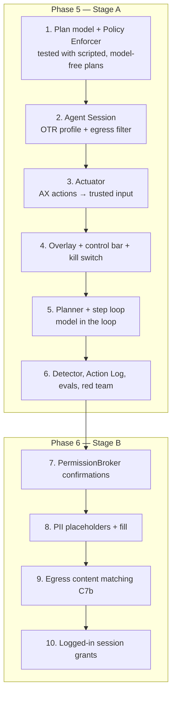

# Phases 5–6 — R3: Supervised Agent (months 20–27+)

**Goal:** the Task Agent, introduced in two capability stages ([doc 06 §5.3](../06-ai-security-privacy.md#53-stage-gates-for-the-agent)).

| Phase | Stage | Tiers | Session | Exit |
|---|---|---|---|---|
| **5** (~20 weeks) | **Stage A** | T0, T1 Navigate, T2 Interact | Isolated Agent Session only | Gate **G5**: opt-in agent beta |
| **6** (~12 weeks+) | **Stage B** | + T3 Personal data, T4 Commit | + per-origin grant to use the user's logged-in session | Gate **G6**: Stage B release |

**The rule that shapes everything here:** the model proposes and the browser decides. Every security property is enforced by deterministic code in `AgentController`'s Policy Enforcer, and must be testable without a model in the loop (ADR-011). Build and test the enforcement layer **before** the planner is good. A smart agent behind a weak enforcer is the failure mode this plan exists to prevent.

---

## 1. Build order



---

## 2. The plan is data, not text

```cpp
// vizulla/browser/agent/plan.h
enum class Tier { kT0Read, kT1Navigate, kT2Interact, kT3PersonalData, kT4Commit };

struct PlanStep {
  int index;
  std::u16string label;            // shown to the user
  url::Origin origin;              // where the step acts
  Tier max_tier;                   // the highest tier this step may use
  std::vector<std::string> data_fields;  // Stage B: e.g. "profile.name", "profile.phone"
};

struct ApprovedPlan {
  base::Uuid id;
  std::u16string goal;
  std::vector<PlanStep> steps;
  base::flat_set<url::Origin> allowed_origins;   // union of step origins + search provider
  base::flat_map<std::string, std::u16string> user_values;  // values the user typed in the plan
  SessionMode session;             // kIsolated (Stage A) | kUserSessionGrant (Stage B, per origin)
  base::Time approved_at, expires_at;
};
```

The planner model outputs JSON against a schema. The browser **parses and validates** it into an `ApprovedPlan` candidate (unknown origins, an unknown tier, or a missing label → rejected), and shows it in the native plan-approval UI ([doc 05 §8.3](../05-architecture-prototype.md#83-agent-plan-approval-browser-owned-ui)). Only what the user approves becomes an `ApprovedPlan`. Editing the plan in the UI changes the data, not a prompt.

### 2.1 Policy Enforcer

```cpp
// vizulla/browser/agent/policy_enforcer.cc (sketch)
Verdict PolicyEnforcer::Check(const ApprovedPlan& plan, const ToolCall& call,
                              const ExecutionState& state) {
  if (base::Time::Now() > plan.expires_at)                 return Reject(kPlanExpired);
  if (!plan.allowed_origins.contains(call.target_origin))  return NeedsApproval(kNewOrigin);
  const PlanStep& step = plan.steps[state.current_step];
  if (TierOf(call.tool) > step.max_tier)                   return Reject(kTierExceeded);
  if (TierOf(call.tool) >= Tier::kT3PersonalData && !stage_b_enabled_)
                                                           return Reject(kStageDisabled);
  for (const auto& value : call.outgoing_values) {
    if (!IsAllowedSource(value, plan, call.target_origin))  // AGT-12 / C7a
                                                           return Reject(kDisallowedData);
  }
  if (IsCommit(call.tool))                                 return NeedsConfirmation(call);
  return Allow();
}
```

`IsAllowedSource` relies on **provenance tracking**: every string the agent can type carries a source tag set by the browser (user plan value, profile field X, or text read from origin Y). The model refers to values by handle (`{{value:v3}}`), not by copying text. A value with no valid handle is treated as model-generated free text, which T2 allows only for non-PII fields, and is limited in length.

**Tests:** the enforcer has a model-free test suite of ≥ 300 scripted attack plans and tool calls (off-plan origins, tier escalation, data from another origin, expired plans, replayed calls). The suite runs on every PR touching `browser/agent/`, and must be 100% green to merge.

---

## 3. Phase 5 — Stage A tasks

| ID | Task | Depends | Est. | SRS | Done when |
|---|---|---|---|---|---|
| P5-AI-01 | **Plan model + schema + validator** (§2) | — | 2 ew | AGT-01 | Fuzzed validator. Rejects malformed or over-scoped plans. |
| P5-SEC-01 | **Policy Enforcer** + the model-free attack suite (§2.1) | 01 | 4 ew | AGT-05/11/12 | 100% of the suite enforced |
| P5-BRW-01 | **Agent Session** (DD-10): a non-primary off-the-record profile per task, with no access to the user's cookies, storage, or extensions. Destroyed at task end (doc 06 §7). | — | 2 ew | AGT-07, C5 | Browser test: the agent tab cannot read cookies set in the user profile |
| P5-BRW-02 | **Egress filter** for agent tabs: a `URLLoaderFactory` proxy (same mechanism as Shields) blocking every request to origins outside `allowed_origins`, except subresources the user's Shields allow from those origins' pages (a decision to make: strict mode first) | 01 | 3 ew | C7a | Off-plan requests blocked and logged. Site-compat measured on the benchmark sites. |
| P5-BRW-03 | **Actuator** (DD-11): observe through AX snapshots (diffed between steps). Act through AX actions (`kDoDefault`, `kSetValue`, `kFocus`, `kScrollToMakeVisible`). Fall back to trusted input events at the node's bounds. Every action targets a node ID from the **latest** snapshot, so a stale ID means re-observe. | — | 5 ew | AGT-02/03 | Works on ≥ 90% of benchmark steps without the vision fallback |
| P5-AI-02 | **Vision fallback** (last resort): a screenshot of the agent tab only → the model proposes a coordinate → mapped back to an AX node where possible. Still goes through the enforcer. | 03 | 3 ew | AGT-02 | Used only when the AX path fails. Logged. |
| P5-BRW-04 | **Agent overlay + control bar** (native Views, C9): the step label, the highlighted target, Pause / Take over / Stop, and `Esc` as the kill switch (C16). The bar sits outside the page content area. | 03 | 3 ew | AGT-03 | Spoof test: page content cannot cover or imitate the bar |
| P5-AI-03 | **Planner + step loop**: goal → plan (cloud model by default) → approval → observe → next action → enforcer → act → checkpoint. Retry and replan limits. Stops on any rejection that the user does not resolve. | 01, SEC-01, BRW-03 | 6 ew | AGT-01..03 | Runs the benchmark end to end |
| P5-AI-04 | **WebMCP bridge** (flag, C6): discover declared tools on plan origins, map each to a tier, call them through the same enforcer | 03 | 2 ew | AI-07 | Demo site works. Disabled by default. |
| P5-AI-05 | **Injection detector** for agent observations (advisory, C2): it pauses and asks the user, and its verdicts are logged. It cannot allow anything. | — | 3 ew | AGT-09 | Detection rate reported on the corpus (not a gate) |
| P5-BRW-05 | **Action Log** (`vizulla://agent-log`): every observation summary, tool call, enforcer verdict, confirmation record, and reasoning summary. 30-day TTL. Undo where possible. | 03 | 3 ew | AGT-08, C15 | Every executed action appears with its verdict |
| P5-PLT-01 | **Build gating**: agent code compiled in only for Nightly/Beta until G5. A variations-controlled tester audience. SEC-09 auto-disable when the build is > 14 days behind upstream security releases. | — | 1.5 ew | SEC-09 | Stable binaries contain no agent code before G5 |
| P5-AI-06 | **Agent benchmark**: 100 tasks on WPR-recorded and live test sites, with graders (success, steps, takeovers, off-plan attempts) | — | 4 ew | AIQ-02 | Runs nightly |
| P5-SEC-02 | **Injection + exfiltration corpus for agents**: multilingual, including hidden text, image text, and attempts to cross origins. Metric: attempted vs executed off-plan actions. | 05 | 3 ew | AIQ-03 | 0 executed off-plan actions |
| P5-SEC-03 | **Internal red team** (≥ 2 weeks) on the Stage A build | all | 2 ew + team | SEC-07 | No open Critical/High |
| P5-PM-01 | **Agent tester program**: invitation, agreement, opt-in telemetry for agent evals, a feedback channel, ≥ 8 weeks before G5 | P5-PLT-01 | — | doc 07 §2.1 | Running |

### Stage A exit (G5)

- [ ] The enforcer attack suite is 100% green. Browser tests cover AGT-05/07/11.
- [ ] AIQ-03: 0 executed off-plan actions on the corpus.
- [ ] Red team: no open Critical/High. The bug bounty scope includes the agent.
- [ ] Tester program has run for ≥ 8 weeks, with its findings triaged.
- [ ] The agent is disabled automatically on stale builds (SEC-09 tested).

---

## 4. Phase 6 — Stage B tasks

| ID | Task | Depends | Est. | SRS | Done when |
|---|---|---|---|---|---|
| P6-BRW-01 | **PermissionBroker confirmations** (native Views): for each T4 action, show the exact destination origin, the exact fields and values to be sent, and what will happen ("Submit booking"). Confirm / Edit / Cancel. Users cannot confirm with a keypress that was already held down (no accidental confirms). | Stage A | 4 ew | AGT-04, C6 | Spoof tests pass |
| P6-AI-01 | **PII placeholders**: profile fields (from the autofill profile) are exposed to the model as named handles only (`{{profile.phone}}`). The browser fills the real values after T3 confirmation. | P6-BRW-01 | 3 ew | AGT-12, T3 | The model context never contains raw profile values (tested) |
| P6-SEC-01 | **Egress content matching** (C7b): before a navigation or submit, scan the outgoing URL and body for known private values from other origins, Memory, or the profile. A match blocks the action and asks the user. | Stage A | 3 ew | C7b | Exfiltration corpus measured. False-positive rate on the benchmark ≤ 2%. |
| P6-BRW-02 | **Logged-in session grant**: a per-origin, time-limited grant (default 30 min) that lets the agent drive a tab in the user's **regular** profile for that origin only. Every other origin stays blocked by the egress filter. The grant is visible in the control bar and revocable. | P6-BRW-01 | 4 ew | AGT-07, C5 | Grant scope enforced in browser tests. It expires on time. |
| P6-BRW-03 | **Credential handling**: the agent can reach a login page, but credential fill (T5) remains **out of scope**. The agent stops and asks the user to sign in themselves (AGT-06). | — | 1 ew | AGT-06, C8 | Tested on the benchmark's login steps |
| P6-UX-01 | **Confirmation usability study**: can users spot a wrong destination or wrong data in the confirmation? | 01 | 2 ew | doc 06 §5.3 | ≥ 90% detection |
| P6-SEC-02 | **External pentest** of confirmations, egress rules, grants, and the enforcer | all | vendor | SEC-07 | No open Critical/High |
| P6-AI-02 | **Benchmark with commit actions**: AIQ-02 ≥ 80% success, 0 unconfirmed sensitive actions | all | 2 ew | AIQ-02 | Met |

### Stage B exit (G6)

- [ ] Everything in G5, still true.
- [ ] AIQ-02 ≥ 80%, with 0 unconfirmed commit actions.
- [ ] External pentest closed. C7b measured and reported.
- [ ] Confirmation study ≥ 90%.
- [ ] DPIA updated for agent data (the Action Log, grants).
